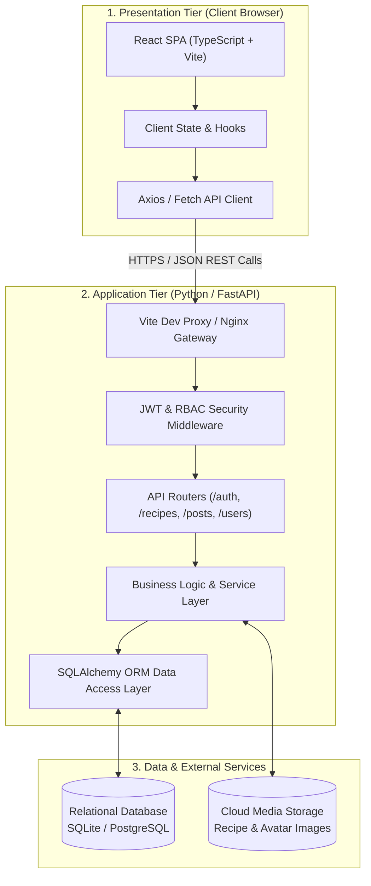
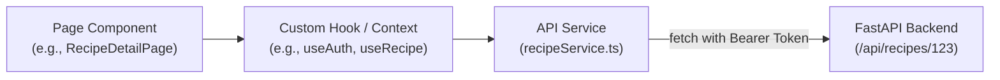
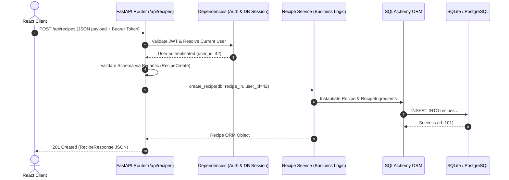
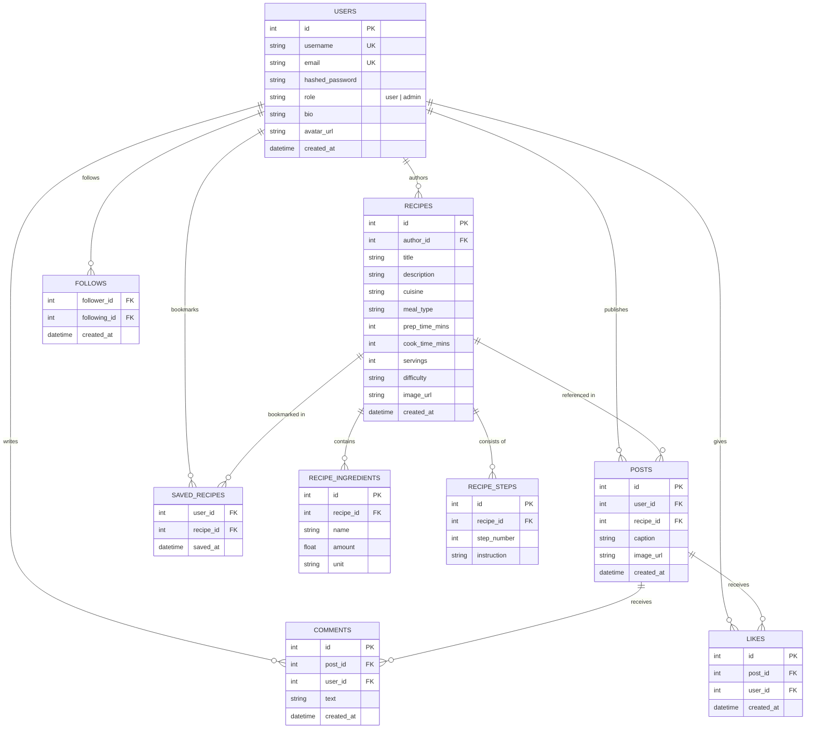
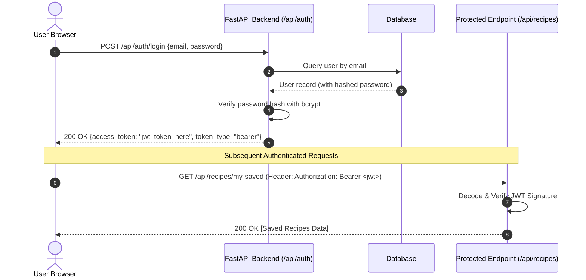

# System Architecture Design — Simmer

**Project Name:** Simmer — Cooking Social Media Web Application  
**Course:** CSE 115a / CMPS 115 — Software Engineering & Methodology  
**Document Revision:** 1.0  
**Date:** October 11, 2026  
**Authors:** Team Simmer (Maximo Mora, Bryan Moreno, Ulises Diaz, John Weaver, Benjamin Ong)  

---

## 1. Architectural Style & Overview

Simmer employs a **Three-Tier Layered Client-Server Architecture** utilizing a decoupled frontend and backend communicating over stateless RESTful HTTP APIs with JSON payloads:

1. **Presentation Tier (Frontend):** Single Page Application (SPA) built with **React**, **TypeScript**, and **Vite**.
2. **Application / Business Logic Tier (Backend):** Asynchronous REST API service powered by **Python 3.11+** and **FastAPI**.
3. **Data Tier (Persistence):** Relational database managed via **SQLAlchemy ORM** (**SQLite** for local development, **PostgreSQL** for staging/production).



---

## 2. Frontend Subsystem Architecture (TypeScript / React)

The frontend is structured into modular layers to isolate UI layout, state management, and network communication:

```
frontend/src/
├── components/
│   ├── common/
│   ├── recipes/
│   └── social/
├── pages/
│   ├── HomeFeedPage.tsx
│   ├── LoginPage.tsx
│   ├── RegisterPage.tsx
│   ├── RecipeDetailPage.tsx
│   ├── CreateRecipePage.tsx
│   └── ProfilePage.tsx
├── services/
│   ├── api.ts
│   ├── authService.ts
│   ├── recipeService.ts
│   └── socialService.ts
├── hooks/
├── context/
└── types/
```

### Component Interaction Flow


---

## 3. Backend Subsystem Architecture (Python / FastAPI)

The backend follows the **Controller-Service-Repository** pattern to ensure separation of concerns, testability, and clean code boundaries:

```
backend/app/
├── api/
│   ├── deps.py
│   └── v1/
│       ├── auth.py
│       ├── users.py
│       ├── recipes.py
│       └── posts.py
├── core/
│   ├── config.py
│   ├── security.py
│   └── database.py
├── models/
│   ├── user.py
│   ├── recipe.py
│   ├── post.py
│   └── social.py
├── schemas/
│   ├── user_schema.py
│   ├── recipe_schema.py
│   └── post_schema.py
├── services/
│   ├── auth_service.py
│   ├── recipe_service.py
│   └── grocery_service.py
└── main.py
```

### Backend Request Lifecycle


---

## 4. Database Schema & Entity-Relationship Architecture

The relational schema supports user identities, recipe authoring with multi-step instructions, and social engagement:



---

## 5. Security Architecture & Authentication Workflow

Simmer implements **JSON Web Token (JWT) Bearer Authentication** using cryptographic signatures (`HS256`):

1. **Password Security:** User passwords are never stored in plain text. Passwords are salted and hashed using `bcrypt` via Passlib.
2. **Access Tokens:** Signed with a secret key (`SECRET_KEY`), encoding `sub` (user ID), `role` (user or admin), and `exp` (expiration time, typically 24 hours).
3. **Role-Based Access Control (RBAC):** Admin-only endpoints verify `role == "admin"` before executing administrative operations.
4. **CORS Isolation:** Local development restricts origin access to `http://localhost:5173`.



---

## 6. RESTful API Endpoint Architecture

| Subsystem | Method | Endpoint Path | Auth Required | Description |
| :--- | :---: | :--- | :---: | :--- |
| **Authentication** | `POST` | `/api/v1/auth/register` | No | Creates a new user account |
| **Authentication** | `POST` | `/api/v1/auth/login` | No | Authenticates credentials, returns JWT token |
| **Authentication** | `GET` | `/api/v1/auth/me` | Yes | Retrieves authenticated user profile |
| **Users** | `PUT` | `/api/v1/users/profile` | Yes | Updates profile bio, avatar, dietary tags |
| **Users** | `GET` | `/api/v1/users/{id}` | No | Retrieves public user profile |
| **Recipes** | `GET` | `/api/v1/recipes` | No | Lists recipes with pagination and filtering |
| **Recipes** | `POST` | `/api/v1/recipes` | Yes | Creates a new recipe with ingredients & steps |
| **Recipes** | `GET` | `/api/v1/recipes/{id}` | No | Retrieves detailed recipe information |
| **Recipes** | `PUT` | `/api/v1/recipes/{id}` | Yes | Updates recipe (author only) |
| **Recipes** | `DELETE`| `/api/v1/recipes/{id}` | Yes | Deletes recipe (author or admin only) |
| **Recipes** | `GET` | `/api/v1/recipes/saved` | Yes | Retrieves user's bookmarked recipes |
| **Social** | `GET` | `/api/v1/posts/feed` | Yes | Retrieves community post activity feed |
| **Social** | `POST` | `/api/v1/posts` | Yes | Shares a new culinary post |
| **Social** | `POST` | `/api/v1/posts/{id}/like` | Yes | Toggles like on a post |
| **Social** | `POST` | `/api/v1/posts/{id}/comments` | Yes | Adds a comment to a post |
| **Admin** | `GET` | `/api/v1/admin/users` | Admin Only | Moderation view of all platform accounts |

---

## 7. Technology Tradeoffs & Architectural Decisions

| Decision | Chosen Technology | Alternatives Considered | Rationale |
| :--- | :--- | :--- | :--- |
| **Backend Framework** | **FastAPI** | Flask, Django | FastAPI provides native asynchronous performance, automatic Pydantic data validation, type hints, and **auto-generated interactive OpenAPI/Swagger docs (`/docs`)**, allowing frontend developers to test endpoints immediately. |
| **Frontend Framework** | **React + Vite + TS** | Next.js, Plain HTML/JS | Vite provides lightning-fast Hot Module Replacement (HMR) and a built-in `/api` proxy. TypeScript ensures compile-time type safety matching the backend schemas. |
| **Database ORM** | **SQLAlchemy 2.0** | Raw SQL, Tortoise ORM | SQLAlchemy is the industry standard for Python. It allows identical model code to run against local SQLite during Sprint 1 development and PostgreSQL in production without code changes. |
| **Repository Pattern** | **Monorepo** | Polyrepo (2 separate repos) | Placing `/frontend` and `/backend` in one repository simplifies sprint planning, unified pull requests, and GitHub Projects issue tracking for a 5-student team. |
