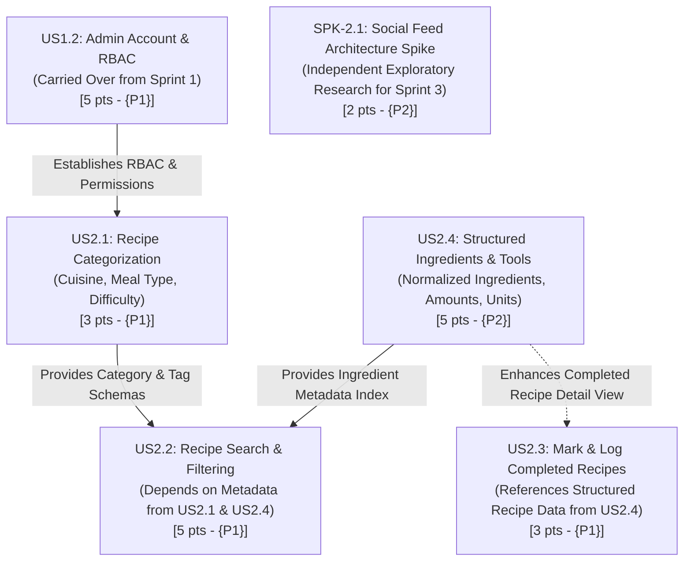

# Sprint 2 Plan — CMPS 115 Software Methodology

**Document Name:** Sprint 2 Plan  
**Product Name:** Simmer  
**Team Name:** Team Simmer (Maximo Mora, Bryan Moreno, Ulises Diaz, John Weaver, Benjamin Ong)  
**Sprint Period:** October 26, 2026 – November 8, 2026  
**Sprint Completion Date:** November 8, 2026  
**Revision:** 1.0  
**Revision Date:** October 21, 2026  

---

## 1. Sprint Goal

> **Goal:** Complete and deploy the administrative moderation dashboard and role-based access control (carried over from Sprint 1), while enhancing Simmer's core recipe capabilities through comprehensive categorization, multi-criteria keyword search, structured ingredient/tool specifications, personal cooking history logging, and conducting an exploratory spike on social feed architectures.

---

## 2. Dependency Analysis Among Sprint 2 Items

Before task scheduling, the team conducted an intra-sprint dependency analysis to account for the carried-over admin story and optimize development order without blocking team members:



### Detailed Dependency Breakdown:
1. **US1.2 (Admin Account & RBAC — Carried Over from Sprint 1):**
   - *Technical Reason:* US1.2 relies on the baseline user authentication schema from Sprint 1 (US1.1). In Sprint 2, it establishes the permissions framework (`role == 'admin'`), ensuring recipe moderation and user management endpoints are secure. It is scheduled at the start of Week 1 so that administrative guards are active across all new recipe routes.
2. **US2.2 (Search Recipes) depends on US2.1 (Categorization) & US2.4 (Structured Ingredients):**
   - *Technical Reason:* While basic title search can be implemented independently, multi-facet filtering requires the category enumerations from **US2.1** (`cuisine`, `meal_type`, `difficulty`) and the ingredient indexing from **US2.4** (`ingredient_name`). John and Ulises complete these schemas in Week 1 so Maximo can wire up faceted search filters in Week 2.
3. **US2.3 (Mark/Log Completed Recipes) loosely depends on US2.4 (Structured Ingredients):**
   - *Technical Reason:* When a user marks a recipe as completed, the profile history tab renders the ingredients and tools used. Reusing the ingredient display components built in US2.4 ensures complete summaries in the cooking log.
4. **SPK-2.1 (Social Feed Spike) is Independent:**
   - *Technical Reason:* An exploratory research spike conducted by Bryan Moreno in an isolated branch to benchmark feed architectures in preparation for Sprint 3.

---

## 3. Task Listing (Organized by User Story in Priority Order)

*Note: In accordance with CMPS 115 guidelines, all task estimates are $\le 6$ ideal engineering hours. Stories are listed in strict priority order ({P1} to {P2}).*

### User Story 1 (Priority {P1} — 5 Story Points | Associated Goal 1 | Carried Over from Sprint 1)
**US1.2:** *As an administrator, I want an admin role and dashboard so that I can manage system settings, review accounts, and assist users.*

- **Task 2.1:** Design administrative navigation and user management console interface — *3 hours*
- **Task 2.2:** Extend database schema with user roles, privileges, and admin audit flags — *3 hours*
- **Task 2.3:** Implement role-based access control (RBAC) middleware and token validation — *4 hours*
- **Task 2.4:** Build admin management API endpoints (view users, flag/edit status) — *5 hours*
- **Task 2.5:** Connect admin frontend view to admin management endpoints with error handling — *3 hours*
- **Task 2.6:** Conduct end-to-end security and role escalation testing — *5 hours*  
**Total for User Story 1 (US1.2): 23 hours**

---

### User Story 2 (Priority {P1} — 3 Story Points | Associated Goal 2)
**US2.1:** *As a user, I want to categorize recipes by cuisine, meal type, and difficulty so that my collection remains organized.*

- **Task 1.1:** Update database schema with category fields (`cuisine`, `meal_type`, `difficulty`) and write Alembic migration script — *3 hours*
- **Task 1.2:** Design and implement frontend category badge selector and tag pills in recipe creation form — *4 hours*
- **Task 1.3:** Update backend recipe CRUD endpoints to validate and persist category enumerations — *3 hours*
- **Task 1.4:** Build frontend category filter bar on recipe library/discovery page — *4 hours*
- **Task 1.5:** Write automated unit and integration tests for category validation and tag query filters — *4 hours*  
**Total for User Story 2 (US2.1): 18 hours**

---

### User Story 3 (Priority {P1} — 5 Story Points | Associated Goal 3)
**US2.2:** *As a user, I want to search recipes by title and keywords so that I can quickly locate specific meals.*

- **Task 3.1:** Implement backend search endpoint with text indexing and case-insensitive SQL query logic — *5 hours*
- **Task 3.2:** Design and implement responsive search input component with debounce and loading spinner in React — *4 hours*
- **Task 3.3:** Integrate multi-facet filtering (combining text search with US2.1 categories and US2.4 ingredients) — *5 hours*
- **Task 3.4:** Build search results grid with empty state ("No recipes found") and active filter clear buttons — *3 hours*
- **Task 3.5:** Write automated test suite for search query edge cases, SQL injection prevention, and empty results — *5 hours*  
**Total for User Story 3 (US2.2): 22 hours**

---

### User Story 4 (Priority {P1} — 3 Story Points | Associated Goal 2)
**US2.3:** *As a user, I want to mark and log recipes I have completed so that I can track my cooking history.*

- **Task 4.1:** Design and create `completed_recipes` database join table with user ID, recipe ID, timestamp, and notes — *3 hours*
- **Task 4.2:** Build backend API endpoints to log a recipe as cooked (`POST /recipes/{id}/complete`) and fetch history — *4 hours*
- **Task 4.3:** Design "I Cooked This!" interactive button and date-logged popup modal in React — *3 hours*
- **Task 4.4:** Build "Cooking History" log tab on User Profile page displaying completed recipe cards and dates — *4 hours*
- **Task 4.5:** Write integration tests for cooking history persistence and prevention of invalid duplicate timestamps — *3 hours*  
**Total for User Story 4 (US2.3): 17 hours**

---

### User Story 5 (Priority {P2} — 5 Story Points | Associated Goal 2)
**US2.4:** *As a user, I want to specify structured ingredient lists and required kitchen tools so that I know what is needed before cooking.*

- **Task 5.1:** Design and migrate relational database schema for `recipe_ingredients` (amount, unit, name) and `kitchen_tools` — *4 hours*
- **Task 5.2:** Build dynamic "Add Ingredient" row component with unit dropdowns (g, oz, cup, tbsp) in React — *5 hours*
- **Task 5.3:** Build "Required Kitchen Tools" tag input selector in the recipe authoring interface — *3 hours*
- **Task 5.4:** Update backend recipe ingestion service to parse, sanitize, and persist structured ingredients — *4 hours*
- **Task 5.5:** Render formatted ingredient checklist and required tools drawer on the Recipe Detail view — *4 hours*
- **Task 5.6:** Write automated test cases for structured ingredient validation, unit conversions, and tool associations — *4 hours*  
**Total for User Story 5 (US2.4): 24 hours**

---

### Spike 1 (Priority {P2} — 2 Story Points | Associated Goal 4)
**SPK-2.1:** *Spike: Evaluate social activity feed data models (relational queries vs. timeline caching) in preparation for Sprint 3 interactions.*

- **Task 6.1:** Research and benchmark fan-out-on-read vs. fan-out-on-write feed architectures for social post delivery — *4 hours*
- **Task 6.2:** Create prototype spike branch testing follower-based query performance in SQLite/PostgreSQL and document findings — *4 hours*  
**Total for Spike 1: 8 hours**

---

## 4. Workload Summary

- **Total Planned Workload:** 112 Ideal Engineering Hours (89 hrs Sprint 2 core + 23 hrs US1.2 rollover)
- **Total Story Points:** 23 Points (18 pts Sprint 2 core + 5 pts US1.2 rollover)
- **Team Size:** 5 Members
- **Average Workload:** $112 \div 5 = 22.4\text{ ideal hours per member}$ across the 2-week sprint (~11.2 hours/week per developer).
- **Scope Reconciliation:** During Sprint 1, US1.2 was deferred to establish robust foundational authentication and database stability. By rolling US1.2 into Sprint 2, the team's planned commitment shifts from 18 to 23 points. This workload aligns with nominal team capacity ($22.4\text{ hrs/person}$ over 2 weeks), with tasks distributed across backend, database, and frontend pairs.

---

## 5. Team Roles for Sprint 2

| Team Member | Role(s) | Primary Sprint Responsibilities |
| :--- | :--- | :--- |
| **Maximo Mora** | Product Owner (PO), Full-Stack Developer | Admin navigation UI (US1.2), recipe search UI integration, faceted filter logic, and acceptance testing. |
| **Bryan Moreno** | Scrum Master, DevOps / Backend Developer | RBAC token validation and admin endpoints (US1.2), search query optimization, and lead on SPK-2.1 spike. |
| **Ulises Diaz** | Frontend Developer, UI/UX Lead | Admin console styling, dynamic ingredient/tool authoring components, category badges, and history tab. |
| **John Weaver** | Database Architect, Backend Developer | Database schema extensions for user roles/audit flags (US1.2), categories, structured ingredients, and completed recipes. |
| **Benjamin Ong** | QA & Testing Lead, Developer | End-to-end security/escalation testing (US1.2), automated search regression tests, and structured data validation. |

---

## 6. Initial Task Assignment

Every team member has been assigned their starting item and initial task for Day 1:

| Team Member | Initial Story / Item | Initial Task Assignment | Estimated Hours |
| :--- | :--- | :--- | :---: |
| **Bryan Moreno** | **US1.2** (Admin RBAC) | **Task 2.3:** Implement role-based access control (RBAC) middleware and token validation | 4 hrs |
| **Maximo Mora** | **US1.2** (Admin Console) | **Task 2.1:** Design administrative navigation and user management console interface | 3 hrs |
| **John Weaver** | **US1.2** (Admin DB Schema) | **Task 2.2:** Extend database schema with user roles, privileges, and admin audit flags | 3 hrs |
| **Ulises Diaz** | **US2.4** (Ingredients/Tools)| **Task 5.2:** Build dynamic "Add Ingredient" row component with unit dropdowns in React | 5 hrs |
| **Benjamin Ong** | **US2.1** (Categorization) | **Task 1.5:** Write automated unit tests for category validation and tag query filters | 4 hrs |

---

## 7. Initial Burnup Chart

- **Document Label:** `Simmer — Sprint 2 Initial Burnup Chart`
- **Sprint Baseline Scope:** 112 ideal hours / 23 story points (16 feature points + 5 rollover points + 2 spike points).
- **Tracking Frequency & Location:** Maintained live in the team GitHub Projects board and physically mirrored on the team whiteboard in the CSE 115 Lab.

```
Hours
120 |------------------------------------------------ Total Scope Line (112h)
100 |                                            /
 80 |                                     /
 60 |                              /
 40 |                       /
 20 |                /
  0 +------+------+------+------+------+------+------+
   Day 1  Day 3  Day 5  Day 7  Day 9  Day 11 Day 14
```

---

## 8. Initial Scrum Board (Sprint Task Board)

| User Story / Item | Tasks Not Started | Tasks in Progress | Tasks Completed |
| :--- | :--- | :--- | :---: |
| **US1.2: Admin Account & Dashboard** *(5 pts - Rollover)* | • Task 2.4: Admin management API endpoints (5h)<br>• Task 2.5: Connect admin frontend to API (3h)<br>• Task 2.6: Security & escalation testing (5h) | • **Task 2.1:** Admin UI console [Maximo, 3h]<br>• **Task 2.2:** User roles DB schema [John, 3h]<br>• **Task 2.3:** RBAC middleware [Bryan, 4h] | *None (Day 1)* |
| **US2.1: Recipe Categorization** *(3 pts)* | • Task 1.1: Category DB schema & migration (3h)<br>• Task 1.2: Category badge selector in form (4h)<br>• Task 1.3: Update backend recipe CRUD endpoints (3h)<br>• Task 1.4: Category filter bar on discovery page (4h) | • **Task 1.5:** Category unit & integration tests [Benjamin, 4h] | *None (Day 1)* |
| **US2.2: Recipe Search & Keywords** *(5 pts)* | • Task 3.1: Backend search endpoint (5h)<br>• Task 3.2: Responsive search input UI with debounce (4h)<br>• Task 3.3: Multi-facet filtering integration (5h)<br>• Task 3.4: Search results grid & empty state (3h)<br>• Task 3.5: Search edge cases test suite (5h) | *(Scheduled after US2.1 category setup)* | *None (Day 1)* |
| **US2.3: Mark & Log Completed Recipes** *(3 pts)* | • Task 4.1: Completed recipes join table (3h)<br>• Task 4.2: Complete recipe API endpoints (4h)<br>• Task 4.3: "I Cooked This" modal in React (3h)<br>• Task 4.4: Cooking history profile tab (4h)<br>• Task 4.5: Cooking log test suite (3h) | *(Scheduled to start in Week 1, Day 3 after US2.1 DB setup)* | *None (Day 1)* |
| **US2.4: Structured Ingredients & Tools** *(5 pts)* | • Task 5.1: Ingredients & tools DB schema (4h)<br>• Task 5.3: Kitchen tools tag selector (3h)<br>• Task 5.4: Backend ingredient array validation (4h)<br>• Task 5.5: Formatted checklist on Recipe Detail (4h)<br>• Task 5.6: Ingredient validation test suite (4h) | • **Task 5.2:** Dynamic "Add Ingredient" row UI component [Ulises, 5h] | *None (Day 1)* |
| **SPK-2.1: Social Feed Architecture Spike** *(2 pts)* | • Task 6.1: Research feed architectures (4h)<br>• Task 6.2: Prototype spike branch testing query performance (4h) | *(Scheduled to start in Week 2)* | *None (Day 1)* |

---

## 9. Scrum Meeting Schedule

The team meets three times per week during the 2-week sprint cycle:

- **Monday:** 10:30 AM – 11:30 AM (In-person, Engineering Lab)
- **Wednesday:** 10:30 AM – 11:30 AM (In-person, Engineering Lab) — **Official TA / Tutor Lab Check-in Meeting**
- **Friday:** 10:30 AM – 11:30 AM (In-person, Engineering Lab / Hybrid)

Standup updates are recorded in the team Discord channel. Blockers are escalated to the Scrum Master immediately. Any schedule revisions will be reported to the TA at least 24 hours in advance.
