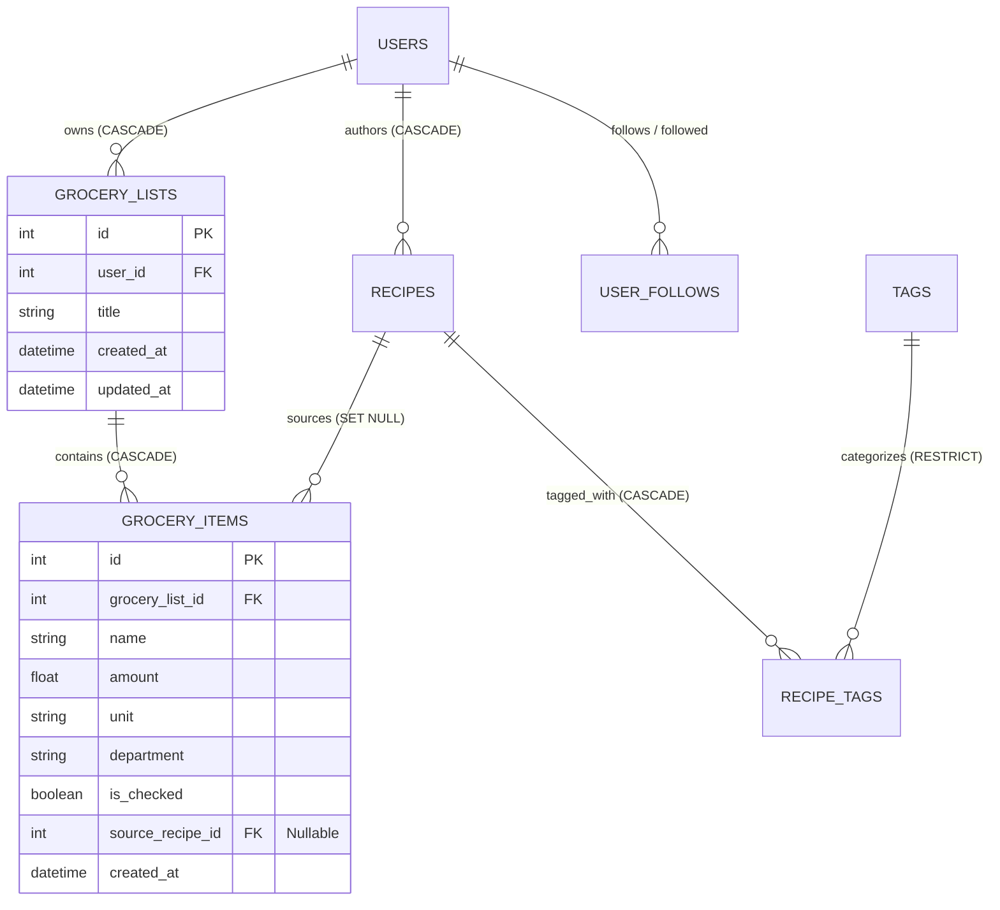

# Technical Specification: Simmer Sprint 4 — Discovery, Grocery Aggregator, Smart Filtering & Staging

**Feature / Milestone:** Sprint 4 — Discovery, Smart Filtering, Grocery Checklist & Production Release  
**Status:** Approved  
**Date:** 2026-11-23  
**Engineering Model:** Full-Stack Vertical Slice Architecture  
**Team Members (Full-Stack Developers):**  
- **Maximo Mora** (Product Owner & Full-Stack Developer — Feature Lead for US4.4)  
- **John Weaver** (Scrum Master & Full-Stack Developer — Infrastructure Lead for INF-4.1)  
- **Bryan Moreno** (Full-Stack Developer — Feature Lead for US4.1)  
- **Ulises Diaz** (Full-Stack Developer — Feature Lead for US4.3)  
- **Benjamin Ong** (Full-Stack Developer — Feature Lead for US4.2)  

**Related Documents:**  
- [intent.md](./intent.md) — Sprint 4 Intent, Non-Goals & Acceptance Scenarios  
- [Sprint_Plan_4.md](../Sprint_Plan_4.md) — Sprint 4 Work Breakdown & Task Estimates  
- [Release_Plan_v1.1.md](../Release_Plan_v1.1.md) — Release Plan & Capacity Analysis  
- [Architecture_Design.md](../Architecture_Design.md) — System Architecture & Data Layer  
- [Code-Standards.md](../Code-Standards.md) — Engineering Guidelines & Naming Rules  
- [Definition_of_Done.md](../Definition_of_Done.md) — Task & Story Quality Criteria  

---

## 1. Scope & Engineering Model

### 1.1 Scope Overview
This specification details the technical contracts, database schemas, Pydantic DTOs, REST API endpoints, frontend component interactions, and verification matrices for Sprint 4 of Simmer (final release of MVP v1.0).

Sprint 4 delivers five major items totaling **23 story points** and **110 ideal engineering hours**:
1. **INF-4.1:** Production Staging Deployment & Configuration — *3 pts (14h)*
2. **US4.1:** Friend Search & Culinary Network — *5 pts (24h)*
3. **US4.2:** Multi-Recipe Grocery Checklist Generator — *5 pts (25h)*
4. **US4.3:** Personalized Discovery Feed & Trending Recipes — *5 pts (24h)*
5. **US4.4:** Smart Dietary & Occasion Filtering (Lead: Maximo Mora) — *5 pts (23h)*

---

### 1.2 Full-Stack Vertical Slice Architecture
All 5 team members continue operating as **Full-Stack Developers**. Each feature slice is owned end-to-end:  
`Database Migration` $\rightarrow$ `FastAPI Route & DTO` $\rightarrow$ `React Component & State` $\rightarrow$ `Automated Pytest & Vitest Suites`.

```
+---------------------------------------------------------------------------------------+
|                             VERTICAL SLICE FEATURE OWNERSHIP                          |
|                                                                                       |
| [INF-4.1: Staging] [US4.1: Friends] [US4.2: Grocery] [US4.3: Trending] [US4.4: Filter]|
+---------------------------------------------------------------------------------------+
| Presentation: React 18, Tailwind CSS, Grocery Checklist UI, Search Dropdown, Carousels|
+---------------------------------------------------------------------------------------+
| Application: FastAPI, Pydantic v2 DTOs, Grocery Aggregator Math, Scoring Engine       |
+---------------------------------------------------------------------------------------+
| Persistence: SQLAlchemy 2.0, PostgreSQL / SQLite, Grocery Tables, Dietary Tag Models   |
+---------------------------------------------------------------------------------------+
| Verification: Automated Pytest Suite (145+ tests) & Vitest Suite (79+ tests)          |
+---------------------------------------------------------------------------------------+
```

---

## 2. Database Schema & Relational Models



### 2.1 Table: `grocery_lists`
Stores user-curated shopping checklists:

| Column | Type | Constraints | Description |
| :--- | :--- | :--- | :--- |
| `id` | Integer | Primary Key, Autoincrement | Unique list ID |
| `user_id` | Integer | Foreign Key (`users.id`, ondelete: CASCADE), Not Null, Index | List owner |
| `title` | String(100) | Not Null, Default: `"My Grocery List"` | Checklist name |
| `created_at` | DateTime | Not Null, Default: `UTC now` | Creation timestamp |
| `updated_at` | DateTime | Not Null, Default: `UTC now` | Last modified timestamp |

### 2.2 Table: `grocery_items`
Stores consolidated ingredient checklist items:

| Column | Type | Constraints | Description |
| :--- | :--- | :--- | :--- |
| `id` | Integer | Primary Key, Autoincrement | Unique item ID |
| `grocery_list_id` | Integer | Foreign Key (`grocery_lists.id`, ondelete: CASCADE), Not Null, Index | Parent checklist |
| `name` | String(100) | Not Null, Index | Stemmed ingredient name |
| `amount` | Float | Not Null, Check (`amount > 0`) | Aggregated quantity |
| `unit` | String(30) | Not Null | Standardized unit (`cup`, `tbsp`, `g`, `oz`, etc.) |
| `department` | String(50) | Not Null, Default: `"Other"`, Index | Grocery store aisle category |
| `is_checked` | Boolean | Not Null, Default: `False` | Completion strike-through status |
| `source_recipe_id` | Integer | Foreign Key (`recipes.id`, ondelete: SET NULL), Nullable, Index | Originating recipe |
| `created_at` | DateTime | Not Null, Default: `UTC now` | Timestamp added |

### 2.3 Curated Dietary & Occasion Tag Seeds (US4.4)
Extends the existing `tags` table with system-curated dietary flags and occasion tags:
- **Dietary Tags:** `#vegan`, `#vegetarian`, `#gluten-free`, `#keto`, `#low-carb`, `#dairy-free`, `#nut-free`.
- **Occasion Tags:** `#quick-dinner`, `#under-30-mins`, `#date-night`, `#meal-prep`, `#comfort-food`, `#kid-friendly`.

---

## 3. Pydantic DTOs & TypeScript Interfaces

### 3.1 Backend Pydantic Schemas

#### Grocery Schemas (`backend/app/schemas/grocery.py`)
```python
from pydantic import BaseModel, Field
from typing import Optional, List
from datetime import datetime

class GroceryItemCreate(BaseModel):
    name: str = Field(..., min_length=1, max_length=100)
    amount: float = Field(..., gt=0)
    unit: str = Field(..., max_length=30)
    department: Optional[str] = Field("Other", max_length=50)
    source_recipe_id: Optional[int] = None

class GroceryItemUpdate(BaseModel):
    is_checked: Optional[bool] = None
    amount: Optional[float] = Field(None, gt=0)
    name: Optional[str] = Field(None, min_length=1, max_length=100)

class GroceryItemOut(BaseModel):
    id: int
    grocery_list_id: int
    name: str
    amount: float
    unit: str
    department: str
    is_checked: bool
    source_recipe_id: Optional[int] = None
    created_at: datetime

class GroceryListGenerate(BaseModel):
    recipe_ids: List[int] = Field(..., min_length=1, max_length=20)
    title: Optional[str] = Field("My Grocery List", max_length=100)

class GroceryListOut(BaseModel):
    id: int
    user_id: int
    title: str
    items: List[GroceryItemOut]
    created_at: datetime
    updated_at: datetime
```

#### Friend Search & Discovery Schemas (`backend/app/schemas/user.py` & `discovery.py`)
```python
class UserSearchResult(BaseModel):
    id: int
    username: str
    avatar_url: Optional[str] = None
    bio: Optional[str] = None
    followers_count: int = 0
    following_count: int = 0
    is_following: bool = False

class UserSearchResponse(BaseModel):
    total: int
    items: List[UserSearchResult]

class TrendingRecipeOut(BaseModel):
    id: int
    title: str
    image_url: Optional[str] = None
    cuisine: Optional[str] = None
    difficulty: str
    cook_time_mins: int
    author_username: str
    trending_score: float
    likes_count: int
    completed_count: int
```

### 3.2 Frontend TypeScript Interfaces (`frontend/src/services/api.ts`)
```typescript
export interface GroceryItem {
  id: number;
  grocery_list_id: number;
  name: string;
  amount: number;
  unit: string;
  department: string;
  is_checked: boolean;
  source_recipe_id?: number | null;
  created_at: string;
}

export interface GroceryList {
  id: number;
  user_id: number;
  title: string;
  items: GroceryItem[];
  created_at: string;
  updated_at: string;
}

export interface UserSearchResult {
  id: number;
  username: string;
  avatar_url?: string | null;
  bio?: string | null;
  followers_count: number;
  following_count: number;
  is_following: boolean;
}

export interface TrendingRecipe {
  id: number;
  title: str;
  image_url?: string | null;
  cuisine?: string | null;
  difficulty: string;
  cook_time_mins: number;
  author_username: string;
  trending_score: number;
  likes_count: number;
}
```

---

## 4. REST API Endpoint Specifications

### 4.1 Friend Search & Network Endpoints (US4.1)
- **`GET /api/v1/users/search`**: Search users by username prefix.
  - *Query Params:* `q` (string, required, min 1 char), `limit` (default: 10, max: 50), `offset` (default: 0).
  - *Auth:* Optional (if authenticated, populates `is_following` boolean flag; strictly excludes the caller's own ID).
  - *Response:* `UserSearchResponse` (200 OK).

### 4.2 Grocery Checklist Endpoints (US4.2)
- **`POST /api/v1/grocery-list/generate`**: Generate a consolidated grocery list from selected recipes.
  - *Auth:* Bearer Token required.
  - *Body:* `GroceryListGenerate` (`{ "recipe_ids": [1, 4, 12], "title": "Weekly Meal Prep" }`).
  - *Response:* `GroceryListOut` (201 Created).
- **`GET /api/v1/grocery-list`**: Retrieve current user's active grocery checklist.
  - *Auth:* Bearer Token required.
  - *Response:* `GroceryListOut` (200 OK).
- **`PATCH /api/v1/grocery-items/{id}`**: Toggle item checked status or update quantity.
  - *Auth:* Bearer Token required (List owner only).
  - *Body:* `GroceryItemUpdate` (`{ "is_checked": true }`).
  - *Response:* `GroceryItemOut` (200 OK).
- **`POST /api/v1/grocery-items`**: Add a manual custom item directly to the checklist.
  - *Auth:* Bearer Token required.
  - *Body:* `GroceryItemCreate`.
  - *Response:* `GroceryItemOut` (201 Created).
- **`DELETE /api/v1/grocery-items/{id}`**: Remove an item from the checklist.
  - *Auth:* Bearer Token required (List owner only).
  - *Response:* 204 No Content.

### 4.3 Discovery & Trending Endpoints (US4.3)
- **`GET /api/v1/recipes/trending`**: Top scored recipes based on engagement gravity formula.
  - *Query Params:* `limit` (default: 10, max: 20).
  - *Response:* `List[TrendingRecipeOut]` (200 OK).
- **`GET /api/v1/recipes/recommended`**: Recipes matched against user's culinary preferences.
  - *Auth:* Bearer Token required (Falls back to top-rated if preferences are empty).
  - *Response:* `List[TrendingRecipeOut]` (200 OK).

### 4.4 Dietary & Occasion Search Extensions (US4.4 — Lead: Maximo Mora)
- **`GET /api/v1/recipes` (Extended):**
  - *New Query Params:*
    - `dietary` (string, optional): Comma-separated dietary flags (e.g. `vegan,gluten-free`).
    - `occasion` (string, optional): Occasion category (e.g. `quick-dinner`, `date-night`).
    - `max_time` (integer, optional): Maximum combined `prep_time_mins + cook_time_mins`.

---

## 5. Frontend Component & UI Specifications

### 5.1 Interactive Grocery Checklist (`frontend/src/pages/GroceryPage.tsx`)
1. **Department Aisle Grouping:** Items organized into collapsible sections:
   - `Produce` (Vegetables, Fruits, Herbs)
   - `Meat & Seafood` (Poultry, Beef, Fish)
   - `Dairy & Refrigerated` (Milk, Cheese, Butter, Eggs)
   - `Pantry & Baking` (Oils, Flours, Spices, Grains)
   - `Other` (Custom items, unclassified)
2. **Interactive Strike-Through:** Clicking an item toggles a checkbox, applies line-through styling, and updates the server optimistically.
3. **Quick Manual Entry Bar:** Input at the top of the checklist to type `"1 gallon milk"` and add it directly.

### 5.2 Recipe "Add to Grocery List" Modal (`AddToGroceryModal.tsx`)
1. Multi-select recipe checklist modal triggerable from `RecipeCard` and `RecipeDetail`.
2. Displays ingredient count preview and an instant "Generate Shopping List" button.

### 5.3 Live Friend Search Bar (`UserSearchDropdown.tsx`)
1. Positioned in the global navigation bar and on `FindFriendsPage.tsx`.
2. 300ms debounced input with active loading spinner and keyboard `ArrowDown`/`Enter` selection.
3. Dropdown shows chef avatar, handle, follower count, and a self-contained `<FollowButton />`.

### 5.4 Dietary & Occasion Drawer (`DietaryFilterDrawer.tsx` — Lead: Maximo Mora)
1. Slide-out filter panel on `RecipesPage.tsx` with multi-select badge chips:
   - **Dietary:** `[ Vegan ] [ Vegetarian ] [ Gluten-Free ] [ Keto ] [ Dairy-Free ]`
   - **Occasions:** `[ Under 30 Mins ] [ Date Night ] [ Meal Prep ] [ Comfort Food ]`
2. "Clear All Filters" reset button and live matching recipe counter.

---

## 6. Full-Stack Vertical Slice Ownership Matrix

*(Strictly aligned with the Sprint 4 Plan and team assignments)*

| Item ID | Points | Full-Stack Owner | Backend & Persistence Deliverables | Frontend UI Deliverables | Verification Suites |
| :---: | :---: | :--- | :--- | :--- | :--- |
| **INF-4.1** | 3 pts | **John Weaver** (Lead) | Production multi-stage Dockerfiles, cloud DB setup, secret management | Production asset minification & bundle audit | Staging CI/CD workflow, health check tests |
| **US4.1** | 5 pts | **Bryan Moreno** (Lead) | `GET /api/v1/users/search`, `is_following` annotations, self-exclusion | `UserSearchDropdown.tsx`, `FindFriendsPage.tsx`, quick-follow | `test_user_search.py`, `UserSearch.test.tsx` |
| **US4.2** | 5 pts | **Benjamin Ong** (Lead) | `grocery_lists` & `grocery_items` schemas, unit aggregation service | `GroceryPage.tsx`, `AddToGroceryModal.tsx`, aisle categories | `test_grocery.py`, `GroceryPage.test.tsx` |
| **US4.3** | 5 pts | **Ulises Diaz** (Lead) | SQLAlchemy trending ranking formula query, `/recommended` route | `TrendingCarousel.tsx` on Home, preference matching cards | `test_trending.py`, `TrendingCarousel.test.tsx` |
| **US4.4** | 5 pts | **Maximo Mora** (Lead) | Extended search query in `recipes.py`, dietary tag seeds | `DietaryFilterDrawer.tsx`, dietary badge chips on cards | `test_dietary_search.py`, `DietaryFilter.test.tsx` |
| **Scrum** | — | **John Weaver** (Scrum Master) | Sprint ceremonies, CI/CD pipeline health, staging verification | Daily standup logs, blocker escalation | Full regression suite (100% pass across all 145+ tests) |
| **PO Sign-off** | — | **Maximo Mora** (Product Owner) | End-to-end integration review against Release Goal 1–5 | Acceptance criteria validation, MVP release sign-off | Playwright E2E browser tests |

---

## 7. Security, Performance & Algorithmic Guardrails

1. **Ingredient Aggregation Math (SPK-3.1 Implementation):**
   - Compatible Volume Units: $1\text{ cup} = 16\text{ tbsp} = 48\text{ tsp} = 8\text{ fl oz}$.
   - Compatible Weight Units: $1\text{ lb} = 16\text{ oz} = 453.59\text{ g}$.
   - If unit conversion is incompatible (e.g. `2 cups sugar` + `1 pinch sugar`), the engine maintains separate rows with distinct units rather than dropping data.
2. **Trending Gravity Formula:**
   $$\text{Score} = \frac{(\text{Likes} \times 2) + (\text{Comments} \times 3) + (\text{CookedLogs} \times 5)}{(\text{HoursSinceCreation} + 2)^{1.5}}$$
   Executed efficiently using an indexed SQL subquery combining counts from `post_likes`, `post_comments`, and `completed_recipes`.
3. **Friend Search Indexing:**
   - Composite index on `users(username, is_active)`.
   - Case-insensitive prefix query: `WHERE lower(username) LIKE :prefix AND is_active = true AND id != :caller_id`.
4. **Data Isolation:** Users can only query and mutate their own `grocery_lists` (enforced via `where grocery_lists.user_id == current_user.id`).

---

## 8. Test Plan & Acceptance Verification Matrix

| Test Suite | Scope | Target Verification | Passing Criteria |
| :--- | :---: | :--- | :--- |
| `tests/test_grocery.py` | API / Service | Aggregation arithmetic, unit conversion, list CRUD, and item toggles | Correct fraction sums; 201 Created; 204 on delete; 400 on negative amounts |
| `tests/test_user_search.py` | API / Query | Username prefix matching, self-search exclusion, deactivated user filtering | Case-insensitive match; caller excluded; inactive users omitted; 200 OK |
| `tests/test_trending.py` | API / Query | Trending formula scoring, decay over time, and preference recommendations | Top scored recipes ordered descending; fallback to newest on cold start |
| `tests/test_dietary_search.py` | API / Query | Multi-select dietary filtering (`vegan` AND `gluten-free`), occasion matching | Strict intersection matching; max_time constraint enforcement |
| `tests/test_regressions.py` | Regression | Full Sprint 1, 2, and 3 suites (Auth, RBAC, Recipes, Posts, Comments, Likes) | **All 145+ existing backend tests pass 100%** |
| `frontend/src/test/*.test.tsx`| Frontend UI | Vitest suites for GroceryPage, UserSearch, TrendingCarousel, DietaryFilter | **All 79+ existing frontend tests pass 100%** |
