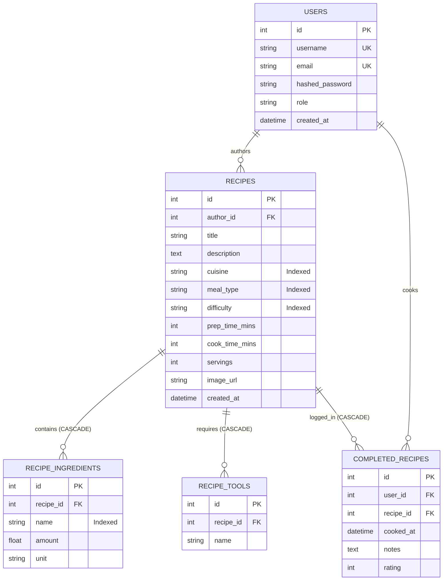

# Technical Specification: Simmer Sprint 2 Recipe Platform, Search & Full-Stack Architecture

**Feature / Milestone:** Sprint 2 — Recipe Categorization, Structured Ingredients, Search & Cooking History  
**Status:** Approved  
**Date:** 2026-10-26  
**Engineering Model:** Full-Stack Vertical Slice Architecture  
**Team Members (Full-Stack Developers):**  
- **Maximo Mora** (Product Owner & Full-Stack Developer)  
- **Bryan Moreno** (Full-Stack Developer & Spike Lead)  
- **Ulises Diaz** (Full-Stack Developer)  
- **John Weaver** (Full-Stack Developer)  
- **Benjamin Ong** (Scrum Master & Full-Stack Developer)  

**Related Documents:**
- [intent.md](./intent.md) — Sprint 2 User Stories & Acceptance Criteria  
- [Sprint_Plan_2.md](../Sprint_Plan_2.md) — Sprint 2 Work Breakdown & Schedule  
- [Architecture_Design.md](../Architecture_Design.md) — System Architecture & Data Layer  

---

## 1. Scope & Engineering Model

### 1.1 Scope Overview
This specification details the technical contracts, database schemas, Pydantic DTOs, REST API endpoints, frontend component interactions, and verification matrices for Sprint 2 of Simmer.

Sprint 2 delivers five core items (18 total story points, 89 ideal engineering hours):
1. **US2.1:** Recipe Categorization (Cuisine, Meal Type, Difficulty) — *3 pts*
2. **US2.2:** Recipe Search by Keywords, Title & Facets — *5 pts*
3. **US2.3:** Mark & Log Completed Recipes (Cooking History) — *3 pts*
4. **US2.4:** Structured Ingredients & Required Kitchen Tools — *5 pts*
5. **SPK-2.1:** Social Feed Architecture Spike (Sprint 3 Preparation) — *2 pts*

---

### 1.2 Full-Stack Vertical Slice Architecture
All 5 team members operate as **Full-Stack Developers**. Instead of organizing the team into horizontal architectural silos (e.g., frontend-only engineers waiting on backend-only engineers), development is executed via **Vertical Slice Architecture**:

```
+-------------------------------------------------------------------------+
|                  VERTICAL SLICE FEATURE OWNERSHIP                        |
|                                                                         |
|  [US2.1: Categorization]   [US2.2: Search]   [US2.3: History]  [US2.4]  |
+-------------------------------------------------------------------------+
|  Presentation Tier: React 18, TypeScript, Tailwind CSS, Vite            |
|  (Components, State Hooks, Form Controls, Filter Badges)                |
+-------------------------------------------------------------------------+
|  Application Tier: FastAPI (Python 3.11+), Pydantic v2 DTOs             |
|  (Routers, Dependency Injection, Query Parsing, Auth Guards)            |
+-------------------------------------------------------------------------+
|  Persistence Tier: SQLAlchemy 2.0 ORM, Alembic Migrations, SQLite       |
|  (Tables, Foreign Keys, Indexes, Cascade Rules)                         |
+-------------------------------------------------------------------------+
|  Verification Tier: Pytest (Backend API/Integration) & Vitest (Frontend)|
+-------------------------------------------------------------------------+
```

#### Core Principles of the Full-Stack Vertical Slice Model:
1. **End-to-End Ownership:** A developer (or pair) assigned to a feature implements the schema migration, backend endpoint, data validation, frontend UI component, and automated tests.
2. **Elimination of Integration Lag:** Eliminates mismatched API contracts because the same developer creates the Pydantic DTO and the corresponding TypeScript interface.
3. **Feature-Branch Isolation:** Each vertical slice is built and tested on its own short-lived feature branch (`feature/us2.x-<feature-name>`) and merged via pull request once the full stack passes CI.
4. **Shared Code Standards:** All team members adhere to consistent type safety (TypeScript strict mode on frontend, Pydantic v2 + type hints on backend) and automated linting.

---

### 1.3 Full-Stack Definition of Done (DoD)
A user story is considered complete **only** when all tiers of the vertical slice meet the following checklist:
- [ ] **Database:** Alembic migration created, bidirectional migrations tested (`upgrade head` and `downgrade -1`), and foreign keys/indexes applied.
- [ ] **Backend API:** FastAPI route registered under `/api/v1/`, Pydantic validation enforced, proper HTTP status codes returned (200, 201, 400, 401, 404, 422).
- [ ] **Frontend UI:** Responsive React component built with Tailwind CSS, error states handled, loading states surfaced, and input debouncing implemented where applicable.
- [ ] **Testing:** Automated Pytest suite covers happy paths, validation failures, and edge cases; regression tests pass 100%.
- [ ] **Documentation:** API contracts documented with OpenAPI/Swagger; docstrings and inline comments preserved.
- [ ] **Code Review:** PR reviewed and approved by at least one other full-stack team member before merging to `main`.

---

## 2. Database Schema & Relational Models



### 2.1 Table: `recipes` (Schema Evolution)
Extends the Sprint 1 baseline `recipes` table with categorization attributes and cooking metrics:

| Column | Type | Constraints | Description |
| :--- | :--- | :--- | :--- |
| `id` | Integer | Primary Key, Autoincrement | Unique recipe ID |
| `author_id` | Integer | Foreign Key (`users.id`), Not Null | Recipe creator |
| `title` | String(150) | Not Null, Index | Recipe title |
| `description` | Text | Nullable | Detailed recipe overview |
| `cuisine` | String(50) | Not Null, Default: `"other"`, Index | Allowed: `"Italian"`, `"Mexican"`, `"Asian"`, `"American"`, `"Mediterranean"`, `"Indian"`, `"French"`, `"other"` |
| `meal_type` | String(50) | Not Null, Default: `"dinner"`, Index | Allowed: `"breakfast"`, `"lunch"`, `"dinner"`, `"dessert"`, `"snack"` |
| `difficulty` | String(20) | Not Null, Default: `"medium"`, Index | Allowed: `"easy"`, `"medium"`, `"hard"` |
| `prep_time_mins` | Integer | Not Null, Default: `0` | Preparation duration in minutes ($\ge 0$) |
| `cook_time_mins` | Integer | Not Null, Default: `0` | Active cooking duration in minutes ($\ge 0$) |
| `servings` | Integer | Not Null, Default: `1` | Number of servings ($\ge 1$) |
| `image_url` | String(255) | Nullable | Public URL for dish photo |
| `created_at` | DateTime | Not Null, Default: `UTC now` | Timestamp of creation |

### 2.2 Table: `recipe_ingredients` (Structured Ingredients)
Replaces unformatted text blobs with normalized amounts and standardized measurement units:

| Column | Type | Constraints | Description |
| :--- | :--- | :--- | :--- |
| `id` | Integer | Primary Key, Autoincrement | Ingredient entry ID |
| `recipe_id` | Integer | Foreign Key (`recipes.id`, ondelete: CASCADE), Not Null, Index | Parent recipe |
| `name` | String(100) | Not Null, Index | Ingredient name (e.g., `"Garlic"`, `"Olive Oil"`) |
| `amount` | Float | Not Null, Check: `amount > 0` | Quantity (e.g., `2.5`, `250.0`) |
| `unit` | String(30) | Not Null | Unit string (e.g., `"g"`, `"ml"`, `"cup"`, `"tbsp"`, `"tsp"`, `"count"`) |

### 2.3 Table: `recipe_tools` (Required Kitchen Equipment)
Stores equipment tags needed to complete the recipe:

| Column | Type | Constraints | Description |
| :--- | :--- | :--- | :--- |
| `id` | Integer | Primary Key, Autoincrement | Tool entry ID |
| `recipe_id` | Integer | Foreign Key (`recipes.id`, ondelete: CASCADE), Not Null, Index | Parent recipe |
| `name` | String(80) | Not Null | Tool name (e.g., `"Cast Iron Skillet"`, `"Blender"`, `"Oven"`) |

### 2.4 Table: `completed_recipes` (Cooking History Log)
Tracks user cooking milestones and notes (US2.3):

| Column | Type | Constraints | Description |
| :--- | :--- | :--- | :--- |
| `id` | Integer | Primary Key, Autoincrement | Cooking log entry ID |
| `user_id` | Integer | Foreign Key (`users.id`, ondelete: CASCADE), Not Null, Index | The user who cooked the dish |
| `recipe_id` | Integer | Foreign Key (`recipes.id`, ondelete: CASCADE), Not Null, Index | The recipe cooked |
| `cooked_at` | DateTime | Not Null, Default: `UTC now` | Date & time cooked |
| `notes` | Text | Nullable | User notes, substitutions, or feedback |
| `rating` | Integer | Nullable, Check: `rating >= 1 AND rating <= 5` | Star rating (1 to 5) |

---

## 3. Pydantic Schemas & TypeScript DTO Interfaces

To maintain seamless synchronization across the full stack, Python backend DTOs map 1:1 to frontend TypeScript interfaces:

### 3.1 Backend Pydantic Schemas (`backend/app/schemas/recipe.py`)
```python
from pydantic import BaseModel, Field
from typing import List, Optional, Literal
from datetime import datetime

# Standard Enumerations
StandardUnit = Literal["g", "kg", "oz", "lb", "cup", "tbsp", "tsp", "ml", "l", "count", "pinch"]
DifficultyLevel = Literal["easy", "medium", "hard"]
MealType = Literal["breakfast", "lunch", "dinner", "dessert", "snack"]

# Ingredient DTOs
class IngredientInput(BaseModel):
    name: str = Field(..., min_length=1, max_length=100)
    amount: float = Field(..., gt=0, description="Amount must be strictly positive")
    unit: StandardUnit

class IngredientResponse(IngredientInput):
    id: int

# Tool DTOs
class ToolInput(BaseModel):
    name: str = Field(..., min_length=1, max_length=80)

class ToolResponse(ToolInput):
    id: int

# Recipe DTOs
class RecipeCreateRequest(BaseModel):
    title: str = Field(..., min_length=2, max_length=150)
    description: Optional[str] = Field(None, max_length=1000)
    cuisine: str = Field("other", max_length=50)
    meal_type: MealType = "dinner"
    difficulty: DifficultyLevel = "medium"
    prep_time_mins: int = Field(0, ge=0)
    cook_time_mins: int = Field(0, ge=0)
    servings: int = Field(1, ge=1)
    image_url: Optional[str] = None
    ingredients: List[IngredientInput] = Field(..., min_items=1)
    tools: List[str] = Field(default_factory=list)
    steps: List[str] = Field(..., min_items=1)

class RecipeDetailResponse(BaseModel):
    id: int
    author_id: int
    author_username: str
    title: str
    description: Optional[str]
    cuisine: str
    meal_type: str
    difficulty: str
    prep_time_mins: int
    cook_time_mins: int
    total_time_mins: int
    servings: int
    image_url: Optional[str]
    ingredients: List[IngredientResponse]
    tools: List[str]
    steps: List[str]
    created_at: datetime

class RecipeSummaryResponse(BaseModel):
    id: int
    title: str
    author_username: str
    cuisine: str
    meal_type: str
    difficulty: str
    cook_time_mins: int
    image_url: Optional[str]

class RecipeSearchFilterParams(BaseModel):
    q: Optional[str] = Field(None, max_length=100, description="Title/keyword query")
    cuisine: Optional[str] = None
    meal_type: Optional[str] = None
    difficulty: Optional[DifficultyLevel] = None
    ingredient: Optional[str] = None
    limit: int = Field(20, ge=1, le=100)
    offset: int = Field(0, ge=0)

# Cooking History DTOs
class LogCookedRequest(BaseModel):
    notes: Optional[str] = Field(None, max_length=500)
    rating: Optional[int] = Field(None, ge=1, le=5)

class CookingHistoryItemResponse(BaseModel):
    id: int
    recipe_id: int
    recipe_title: str
    recipe_image_url: Optional[str]
    cooked_at: datetime
    notes: Optional[str]
    rating: Optional[int]
```

### 3.2 Frontend TypeScript Interfaces (`frontend/src/types/recipe.ts`)
```typescript
export type StandardUnit = "g" | "kg" | "oz" | "lb" | "cup" | "tbsp" | "tsp" | "ml" | "l" | "count" | "pinch";
export type DifficultyLevel = "easy" | "medium" | "hard";
export type MealType = "breakfast" | "lunch" | "dinner" | "dessert" | "snack";

export interface Ingredient {
  id?: number;
  name: string;
  amount: number;
  unit: StandardUnit;
}

export interface RecipeSummary {
  id: number;
  title: string;
  author_username: string;
  cuisine: string;
  meal_type: string;
  difficulty: DifficultyLevel;
  cook_time_mins: number;
  image_url?: string;
}

export interface RecipeDetail extends RecipeSummary {
  author_id: number;
  description?: string;
  prep_time_mins: number;
  total_time_mins: number;
  servings: number;
  ingredients: Ingredient[];
  tools: string[];
  steps: string[];
  created_at: string;
}

export interface CookingHistoryItem {
  id: number;
  recipe_id: number;
  recipe_title: string;
  recipe_image_url?: string;
  cooked_at: string;
  notes?: string;
  rating?: number;
}
```

---

## 4. REST API Endpoint Specifications

### 4.1 Search & Filter Recipes
- **Path:** `GET /api/v1/recipes`
- **Auth:** Optional
- **Query Parameters:** `q`, `cuisine`, `meal_type`, `difficulty`, `ingredient`, `limit` (default 20), `offset` (default 0)
- **Status Code:** `200 OK`
- **Response Payload:**
  ```json
  {
    "total": 45,
    "limit": 20,
    "offset": 0,
    "items": [
      {
        "id": 12,
        "title": "Rustic Garlic Tomato Pasta",
        "author_username": "chef_max",
        "cuisine": "Italian",
        "meal_type": "dinner",
        "difficulty": "easy",
        "cook_time_mins": 20,
        "image_url": "https://images.example.com/pasta.jpg"
      }
    ]
  }
  ```

### 4.2 Create Recipe with Ingredients & Tools
- **Path:** `POST /api/v1/recipes`
- **Auth:** Required (`Bearer <JWT>`)
- **Body:** `RecipeCreateRequest`
- **Status Code:** `201 Created`
- **Response Payload:** `RecipeDetailResponse`
- **Errors:**
  - `400 Bad Request`: Validation failure (e.g., negative amount, unknown unit)
  - `401 Unauthorized`: Missing or expired token

### 4.3 Log Recipe as Cooked (US2.3)
- **Path:** `POST /api/v1/recipes/{id}/complete`
- **Auth:** Required (`Bearer <JWT>`)
- **Body:** `LogCookedRequest`
- **Status Code:** `201 Created`
- **Response Payload:**
  ```json
  {
    "id": 104,
    "recipe_id": 12,
    "user_id": 4,
    "cooked_at": "2026-10-26T19:30:00Z",
    "notes": "Substituted almond flour, turned out crispy!",
    "rating": 5
  }
  ```

### 4.4 Get User's Cooking History
- **Path:** `GET /api/v1/users/me/cooking-history`
- **Auth:** Required (`Bearer <JWT>`)
- **Status Code:** `200 OK`
- **Response Payload:** `List[CookingHistoryItemResponse]` (Ordered by `cooked_at DESC`)

### 4.5 Category & Unit Metadata
- **Path:** `GET /api/v1/recipes/meta/categories`
- **Auth:** Optional
- **Status Code:** `200 OK`
- **Response Payload:**
  ```json
  {
    "cuisines": ["Italian", "Mexican", "Asian", "American", "Mediterranean", "Indian", "French", "other"],
    "meal_types": ["breakfast", "lunch", "dinner", "dessert", "snack"],
    "difficulties": ["easy", "medium", "hard"],
    "units": ["g", "kg", "oz", "lb", "cup", "tbsp", "tsp", "ml", "l", "count", "pinch"]
  }
  ```

---

## 5. Frontend UI/UX Specifications

### 5.1 Recipe Discovery & Search View (`frontend/src/pages/RecipesPage.tsx`)
1. **Debounced Search Bar:** Standard input connected to a custom `useDebounce(searchQuery, 300)` hook. Dispatches query to `GET /api/v1/recipes?q=...` automatically as user types.
2. **Category Filter Badges:** Interactive horizontally scrollable pill buttons:
   - Selecting a pill triggers an immediate filter update without full page reload.
   - Active filters display highlighted badge with an "✕" icon for quick removal.
3. **Recipe Card Grid:** Displays recipe thumbnail, title, author, cuisine badge, difficulty tag, and cook time.
4. **Empty State Component:** Rendered when `items.length === 0`:
   - Headline: *"No recipes match your search criteria."*
   - Subtext: *"Try clearing selected filters or searching with different keywords."*
   - Button: Primary `"Reset All Filters"` button that resets search input and category pills.

### 5.2 Recipe Authoring Form (`frontend/src/pages/CreateRecipePage.tsx`)
1. **Category Selectors:** Accessible dropdowns and tag selector for `cuisine`, `meal_type`, and `difficulty`.
2. **Dynamic Ingredient Row Component:**
   - Amount numeric input (`step="0.1"`, `min="0.01"`)
   - Unit dropdown selector (`g`, `oz`, `cup`, `tbsp`, etc.)
   - Ingredient name text input with auto-trim
   - Red trash-can delete button (disabled if only 1 ingredient remains)
   - Primary `+ Add Ingredient` button at bottom of list
3. **Kitchen Tools Tag Input:** Tag-style input where pressing Enter or comma creates a new required tool badge.

### 5.3 Recipe Detail View & Cooking Log (`frontend/src/pages/RecipeDetailPage.tsx`)
1. **Interactive Ingredient Checklist:** Checkbox for each ingredient to let users cross off items while cooking.
2. **Kitchen Tools Required Drawer:** Clean badge display of needed cookware and tools.
3. **"I Cooked This!" Action Button:**
   - Prominent button triggering a modal dialog:
     - Date cooked picker (defaults to today)
     - 5-star interactive rating component
     - Optional text area for notes (*"Added red chili flakes, delicious!"*)
     - Submit button sends `POST /api/v1/recipes/{id}/complete`
     - Displays success toast notification upon completion

### 5.4 Profile Cooking History Tab (`frontend/src/pages/ProfilePage.tsx`)
1. **Cooking History Tab:** Placed alongside "My Recipes" and "Favorites".
2. **History Cards:** Reverse-chronological timeline of completed dishes featuring recipe thumbnail, title, cooked date, star rating, and user notes.

---

## 6. Full-Stack Vertical Slice Ownership Matrix

Each feature is owned by a full-stack developer (or pair) responsible for the end-to-end slice:

| User Story / Item | Story Points | Full-Stack Owners | Persistence & Backend Deliverables | Frontend UI Deliverables | Automated Verification |
| :--- | :---: | :--- | :--- | :--- | :--- |
| **US2.1: Categorization** | 3 pts | **John Weaver** & **Ulises Diaz** | Alembic migration for `cuisine`, `meal_type`, `difficulty`; enum validation; metadata endpoint | Category badge selectors in recipe form; category filter pills bar | `test_categories.py`: Valid enums, default fallbacks, schema constraint tests |
| **US2.2: Recipe Search** | 5 pts | **Maximo Mora** & **Bryan Moreno** | Indexed search endpoint; case-insensitive text matching; multi-facet SQL filter logic | Debounced search bar; active filter tags; recipe card grid; empty state | `test_search.py`: Keyword search, multi-facet filtering, injection security tests |
| **US2.3: Cooking History** | 3 pts | **Ulises Diaz** & **John Weaver** | `completed_recipes` table; `POST /complete` endpoint; history fetch endpoint | "I Cooked This!" button & modal; Profile cooking history log tab | `test_cooking_history.py`: History persistence, sorting, auth guards |
| **US2.4: Structured Ingredients & Tools** | 5 pts | **Ulises Diaz** & **Benjamin Ong** | `recipe_ingredients` & `recipe_tools` tables with CASCADE delete; array validation | Dynamic ingredient row builder; tool tag input; interactive checklist | `test_ingredients.py`: Numeric checks, unit enums, cascade deletion tests |
| **SPK-2.1: Social Feed Spike** | 2 pts | **Bryan Moreno** | Prototype spike branch benchmarking relational queries vs. fan-out timelines | Architecture documentation and benchmarks for Sprint 3 planning | Feed benchmark script & findings summary report |
| **Regression & Integration** | — | **Benjamin Ong** (Scrum Master / QA) | CI/CD pipeline enforcement, test fixtures, DB isolation | End-to-end user journey validation, error boundary verification | `test_regressions.py`: Sprint 1 Auth, RBAC & Profile suites (100% passing) |

---

## 7. Security, Performance & Data Integrity Guardrails

1. **SQL Injection Defense:** All queries utilize SQLAlchemy 2.0 ORM query constructions or parameterized SQL statements. Dynamic raw string concatenations are strictly prohibited.
2. **Cross-Site Scripting (XSS) Sanitization:** All recipe titles, notes, and descriptions are sanitized upon ingestion and safely rendered by React DOM text nodes.
3. **Authorization & RBAC:**
   - Recipe creation, updating, deletion, and cooking history logging require a valid JWT Bearer token.
   - Cooking history is strictly scoped to the authenticated user (`WHERE user_id = current_user.id`).
4. **Pagination & Query Limits:** Search and listing queries enforce `limit` $\le 100$ and `offset` $\ge 0$ to prevent denial-of-service memory exhaustion.
5. **Referential Integrity:** Deleting a recipe automatically cascades and removes all associated rows in `recipe_ingredients`, `recipe_tools`, and `completed_recipes` via database-level `ON DELETE CASCADE`.

---

## 8. Test Plan & Acceptance Verification Matrix

| Test Suite File | Layer | Target Scope | Passing Criteria |
| :--- | :---: | :--- | :--- |
| `tests/test_categories.py` | Full-Stack Integration | Recipe creation with valid/invalid categories; filter endpoints | HTTP 201 on valid categories; HTTP 422 on invalid enum values; correct default fallbacks |
| `tests/test_ingredients.py` | Full-Stack Integration | Structured ingredient parsing, unit validation, tool tags | HTTP 422 rejected on negative amount or unsupported unit; CASCADE delete verified |
| `tests/test_search.py` | Full-Stack Integration | Text search, multi-facet combination, case-insensitivity | Case-insensitive title match returns results; SQL injection attempts return safe 200/empty; query response time $< 100\text{ms}$ |
| `tests/test_cooking_history.py`| Full-Stack Integration | Recipe completion logging & history retrieval | HTTP 201 created; history ordered by `cooked_at DESC`; HTTP 401 on unauthenticated access |
| `tests/test_regressions.py` | Regression | Sprint 1 Auth, User Profiles, Admin RBAC suites | **All 42 Sprint 1 backend tests continue passing 100%** |
