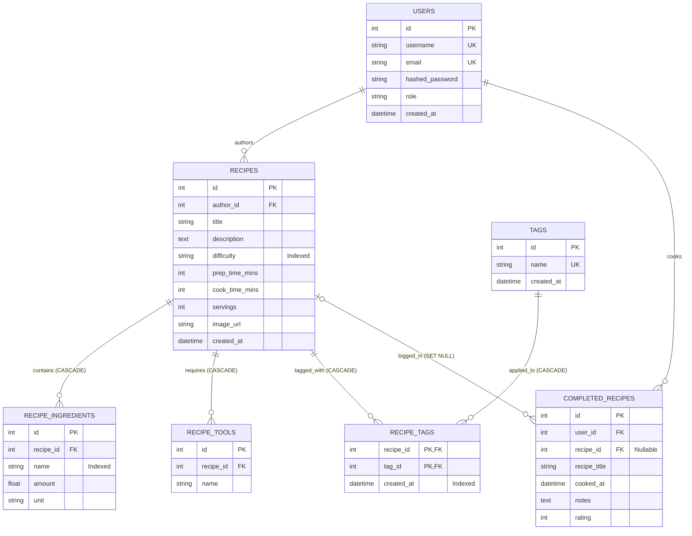

# Technical Specification: Simmer Sprint 2 Recipe Platform, Search & Full-Stack Architecture

**Feature / Milestone:** Sprint 2 — Recipe Tagging, Structured Ingredients, Search & Cooking History  
**Status:** Revision 1.1 — Pending PO Approval (Revision 1.0 approved 2026-10-26)  
**Date:** 2026-10-27  
**Engineering Model:** Full-Stack Vertical Slice Architecture  
**Team Members (Full-Stack Developers):**  
- **Maximo Mora** (Product Owner & Full-Stack Developer)  
- **Bryan Moreno** (Full-Stack Developer & Spike Lead)  
- **Ulises Diaz** (Full-Stack Developer)  
- **John Weaver** (Full-Stack Developer)  
- **Benjamin Ong** (Scrum Master & Full-Stack Developer)  

**Related Documents:**
- [intent.md](./intent.md) — Sprint 2 User Stories & Acceptance Criteria  
- [Sprint_Plan_2.md](../Sprint_Plan_2.md) — Sprint 2 Work Breakdown & Schedule  
- [Architecture_Design.md](../Architecture_Design.md) — System Architecture & Data Layer  

### Revision History
| Revision | Date | Author | Summary |
| :--- | :--- | :--- | :--- |
| 1.0 | 2026-10-26 | Team Simmer | Initial approved Sprint 2 specification |
| 1.1 | 2026-10-27 | John Weaver | Team-agreed design changes: (1) user-created **tags** replace fixed `cuisine` / `meal_type` categories; `difficulty` remains a fixed field; (2) **cooking history survives recipe deletion**; (3) kitchen tools confirmed as creator-entered free text; (4) tags designed to be shared with Sprint 3 posts (recipes will also appear as posts) |

---

## 1. Scope & Engineering Model

### 1.1 Scope Overview
This specification details the technical contracts, database schemas, Pydantic DTOs, REST API endpoints, frontend component interactions, and verification matrices for Sprint 2 of Simmer.

Sprint 2 delivers five core items (18 total story points, 89 ideal engineering hours):
1. **US2.1:** Recipe Tagging & Difficulty (user-created tags, fixed difficulty level) — *3 pts*
2. **US2.2:** Recipe Search by Keywords, Title, Tags & Difficulty — *5 pts*
3. **US2.3:** Mark & Log Completed Recipes (Cooking History) — *3 pts*
4. **US2.4:** Structured Ingredients & Required Kitchen Tools — *5 pts*
5. **SPK-2.1:** Social Feed Architecture Spike (Sprint 3 Preparation) — *2 pts*

### 1.1.1 Forward Compatibility with Sprint 3 Posts
The team has agreed that in Sprint 3, **recipes will also be treated as posts**: every recipe appears in the social feed, users can make quick photo-only posts without a full recipe, and users can switch to a "recipes only" view. Sprint 2 does **not** build posts (see intent.md non-goals), but the tag design below is content-agnostic: the `tags` table is shared, and Sprint 3 will add a `post_tags` link table alongside `recipe_tags` so `#dinner` means the same thing on a recipe and a post.

---

### 1.2 Full-Stack Vertical Slice Architecture
All 5 team members operate as **Full-Stack Developers**. Instead of organizing the team into horizontal architectural silos (e.g., frontend-only engineers waiting on backend-only engineers), development is executed via **Vertical Slice Architecture**:

```
+-------------------------------------------------------------------------+
|                  VERTICAL SLICE FEATURE OWNERSHIP                        |
|                                                                         |
|  [US2.1: Tagging]          [US2.2: Search]   [US2.3: History]  [US2.4]  |
+-------------------------------------------------------------------------+
|  Presentation Tier: React 18, TypeScript, Tailwind CSS, Vite            |
|  (Components, State Hooks, Form Controls, Filter Badges)                |
+-------------------------------------------------------------------------+
|  Application Tier: FastAPI (Python 3.11+), Pydantic v2 DTOs             |
|  (Routers, Dependency Injection, Query Parsing, Auth Guards)            |
+-------------------------------------------------------------------------+
|  Persistence Tier: SQLAlchemy 2.0 ORM, Alembic Migrations, SQLite       |
|  (Tables, Foreign Keys, Indexes, Cascade Rules)                         |
+-------------------------------------------------------------------------+
|  Verification Tier: Pytest (Backend API/Integration) & Vitest (Frontend)|
+-------------------------------------------------------------------------+
```

#### Core Principles of the Full-Stack Vertical Slice Model:
1. **End-to-End Ownership:** A developer (or pair) assigned to a feature implements the schema migration, backend endpoint, data validation, frontend UI component, and automated tests.
2. **Elimination of Integration Lag:** Eliminates mismatched API contracts because the same developer creates the Pydantic DTO and the corresponding TypeScript interface.
3. **Feature-Branch Isolation:** Each vertical slice is built and tested on its own short-lived feature branch (`feature/us2.x-<feature-name>`) and merged via pull request once the full stack passes CI.
4. **Shared Code Standards:** All team members adhere to consistent type safety (TypeScript strict mode on frontend, Pydantic v2 + type hints on backend) and automated linting.

---

### 1.3 Full-Stack Definition of Done (DoD)
A user story is considered complete **only** when all tiers of the vertical slice meet the following checklist:
- [ ] **Database:** Alembic migration created, bidirectional migrations tested (`upgrade head` and `downgrade -1`), and foreign keys/indexes applied.
- [ ] **Backend API:** FastAPI route registered under `/api/v1/`, Pydantic validation enforced, proper HTTP status codes returned (200, 201, 400, 401, 404, 422).
- [ ] **Frontend UI:** Responsive React component built with Tailwind CSS, error states handled, loading states surfaced, and input debouncing implemented where applicable.
- [ ] **Testing:** Automated Pytest suite covers happy paths, validation failures, and edge cases; regression tests pass 100%.
- [ ] **Documentation:** API contracts documented with OpenAPI/Swagger; docstrings and inline comments preserved.
- [ ] **Code Review:** PR reviewed and approved by at least one other full-stack team member before merging to `main`.

---

## 2. Database Schema & Relational Models



### 2.1 Table: `recipes` (Schema Evolution)
Extends the Sprint 1 baseline `recipes` table. Fixed `cuisine` / `meal_type` categories are **replaced by user-created tags** (§2.5–2.6); `difficulty` remains a fixed field because it is an ordered scale used for filtering.

| Column | Type | Constraints | Description |
| :--- | :--- | :--- | :--- |
| `id` | Integer | Primary Key, Autoincrement | Unique recipe ID |
| `author_id` | Integer | Foreign Key (`users.id`), Not Null | Recipe creator |
| `title` | String(150) | Not Null, Index | Recipe title |
| `description` | Text | Nullable | Detailed recipe overview |
| `difficulty` | String(20) | Not Null, Default: `"medium"`, Index | Allowed: `"easy"`, `"medium"`, `"hard"` (validated in the API layer) |
| `prep_time_mins` | Integer | Not Null, Default: `0` | Preparation duration in minutes ($\ge 0$) |
| `cook_time_mins` | Integer | Not Null, Default: `0` | Active cooking duration in minutes ($\ge 0$) |
| `servings` | Integer | Not Null, Default: `1` | Number of servings ($\ge 1$) |
| `image_url` | String(255) | Nullable | Public URL for dish photo |
| `created_at` | DateTime | Not Null, Default: `UTC now` | Timestamp of creation |

#### 2.1.1 Deprecated Columns: `cuisine`, `meal_type` (Two-Phase Removal)
Migration `0002` added nullable `cuisine` and `meal_type` columns. To preserve existing data and avoid breaking code that still reads them, removal happens in two phases:
1. **Phase 1 — Migration `0003_recipe_tags`:** creates `tags` and `recipe_tags`, adds an index on `recipes.difficulty`, and **converts every existing non-empty `cuisine` and `meal_type` value into a normalized tag** linked to its recipe (e.g., cuisine `"Italian"` → tag `italian`; meal type `"Dinner"` → tag `dinner`). Values that cannot be normalized under §2.5.1 are skipped and reported in the migration log. The old columns remain in place, unused by new code.
2. **Phase 2 — Follow-up migration (after the API and frontend use tags):** drops `cuisine` and `meal_type`.

New code **must not** read or write `cuisine` or `meal_type`.

### 2.2 Table: `recipe_ingredients` (Structured Ingredients)
Replaces unformatted text blobs with normalized amounts and standardized measurement units:

| Column | Type | Constraints | Description |
| :--- | :--- | :--- | :--- |
| `id` | Integer | Primary Key, Autoincrement | Ingredient entry ID |
| `recipe_id` | Integer | Foreign Key (`recipes.id`, ondelete: CASCADE), Not Null, Index | Parent recipe |
| `name` | String(100) | Not Null, Index | Ingredient name (e.g., `"Garlic"`, `"Olive Oil"`) |
| `amount` | Float | Not Null, Check: `amount > 0` | Quantity (e.g., `2.5`, `250.0`) |
| `unit` | String(30) | Not Null | Unit string (e.g., `"g"`, `"ml"`, `"cup"`, `"tbsp"`, `"tsp"`, `"count"`) |

### 2.3 Table: `recipe_tools` (Required Kitchen Equipment)
Stores equipment needed to complete the recipe. Tools are **typed by the recipe creator**; there is no pre-defined master list. The frontend may offer autocomplete from tool names already used on other recipes.

| Column | Type | Constraints | Description |
| :--- | :--- | :--- | :--- |
| `id` | Integer | Primary Key, Autoincrement | Tool entry ID |
| `recipe_id` | Integer | Foreign Key (`recipes.id`, ondelete: CASCADE), Not Null, Index | Parent recipe |
| `name` | String(80) | Not Null | Tool name (e.g., `"Cast Iron Skillet"`, `"Blender"`, `"Oven"`) |

### 2.4 Table: `completed_recipes` (Cooking History Log)
Tracks user cooking milestones and notes (US2.3). **History entries survive recipe deletion:** a user still cooked the dish on that date even if the author later deletes the recipe. The recipe title is copied into the log entry at the time of logging so history can still display it.

| Column | Type | Constraints | Description |
| :--- | :--- | :--- | :--- |
| `id` | Integer | Primary Key, Autoincrement | Cooking log entry ID |
| `user_id` | Integer | Foreign Key (`users.id`, ondelete: CASCADE), Not Null, Index | The user who cooked the dish |
| `recipe_id` | Integer | Foreign Key (`recipes.id`, ondelete: **SET NULL**), **Nullable**, Index | The recipe cooked; becomes `NULL` if the recipe is deleted |
| `recipe_title` | String(150) | Not Null | Snapshot of the recipe title when logged |
| `cooked_at` | DateTime | Not Null, Default: `UTC now` | Date & time cooked |
| `notes` | Text | Nullable | User notes, substitutions, or feedback |
| `rating` | Integer | Nullable, Check: `rating >= 1 AND rating <= 5` | Star rating (1 to 5) |

### 2.5 Table: `tags` (User-Created Tags)
Stores each unique tag once. Tags are created implicitly the first time any user applies them. This table is **content-agnostic** so Sprint 3 posts can share it (§1.1.1).

| Column | Type | Constraints | Description |
| :--- | :--- | :--- | :--- |
| `id` | Integer | Primary Key, Autoincrement | Tag ID |
| `name` | String(30) | Not Null, **Unique** | Normalized tag name (e.g., `mexican`, `dinner`, `quick-meals`) |
| `created_at` | DateTime | Not Null, Default: `UTC now` | When the tag was first used |

#### 2.5.1 Tag Normalization & Validation Rules
Applied by the API before storing or searching any tag:
1. Trim surrounding whitespace and remove a single leading `#`.
2. Convert to lowercase.
3. Replace internal runs of whitespace with a single hyphen (`"Mexican Food"` → `mexican-food`).
4. After steps 1–3, the tag must match `^[a-z0-9]+(-[a-z0-9]+)*$` (letters, numbers, single hyphens between words) and be **1–30 characters**. Otherwise the request is rejected with HTTP 422.
5. Duplicate tags in one request (after normalization) are de-duplicated silently.
6. A recipe may have **at most 10 tags**. Tags are **optional** (0 tags is valid).

### 2.6 Table: `recipe_tags` (Recipe ↔ Tag Links)
| Column | Type | Constraints | Description |
| :--- | :--- | :--- | :--- |
| `recipe_id` | Integer | Primary Key (composite), Foreign Key (`recipes.id`, ondelete: CASCADE) | Tagged recipe |
| `tag_id` | Integer | Primary Key (composite), Foreign Key (`tags.id`, ondelete: CASCADE), Index | Applied tag |
| `created_at` | DateTime | Not Null, Default: `UTC now`, Index | When the tag was applied (powers "popular recently") |

The composite primary key prevents the same tag being applied to a recipe twice.

#### 2.6.1 Tag Popularity & Suggestions
- **Popular tags** are computed by counting `recipe_tags` rows per tag with `created_at` within the **last 30 days**, ordered by count descending, then name ascending.
- **Suggested tags** shown before a user types: the **top 8 popular tags**. If fewer than 8 tags have recent usage, the remaining slots are filled from a fixed **starter list** (defined as a backend constant, not stored in the database), skipping any already shown.
- **Starter list:** `dinner`, `breakfast`, `lunch`, `dessert`, `snack`, `vegan`, `vegetarian`, `quick`, `healthy`, `baking`.
- No extra table is required; popularity is a query over `recipe_tags`.

---

## 3. Pydantic Schemas & TypeScript DTO Interfaces

To maintain seamless synchronization across the full stack, Python backend DTOs map 1:1 to frontend TypeScript interfaces:

### 3.1 Backend Pydantic Schemas (`backend/app/schemas/recipe.py`)
```python
from pydantic import BaseModel, Field
from typing import List, Optional, Literal
from datetime import datetime

# Standard Enumerations
StandardUnit = Literal["g", "kg", "oz", "lb", "cup", "tbsp", "tsp", "ml", "l", "count", "pinch"]
DifficultyLevel = Literal["easy", "medium", "hard"]

MAX_TAGS_PER_RECIPE = 10
TAG_MAX_LENGTH = 30

# Ingredient DTOs
class IngredientInput(BaseModel):
    name: str = Field(..., min_length=1, max_length=100)
    amount: float = Field(..., gt=0, description="Amount must be strictly positive")
    unit: StandardUnit

class IngredientResponse(IngredientInput):
    id: int

# Tool DTOs
class ToolInput(BaseModel):
    name: str = Field(..., min_length=1, max_length=80)

class ToolResponse(ToolInput):
    id: int

# Recipe DTOs
class RecipeCreateRequest(BaseModel):
    title: str = Field(..., min_length=2, max_length=150)
    description: Optional[str] = Field(None, max_length=1000)
    tags: List[str] = Field(default_factory=list, max_length=MAX_TAGS_PER_RECIPE,
                            description="Normalized and validated per spec §2.5.1")
    difficulty: DifficultyLevel = "medium"
    prep_time_mins: int = Field(0, ge=0)
    cook_time_mins: int = Field(0, ge=0)
    servings: int = Field(1, ge=1)
    image_url: Optional[str] = None
    ingredients: List[IngredientInput] = Field(..., min_items=1)
    tools: List[str] = Field(default_factory=list)
    steps: List[str] = Field(..., min_items=1)

class RecipeDetailResponse(BaseModel):
    id: int
    author_id: int
    author_username: str
    title: str
    description: Optional[str]
    tags: List[str]
    difficulty: str
    prep_time_mins: int
    cook_time_mins: int
    total_time_mins: int
    servings: int
    image_url: Optional[str]
    ingredients: List[IngredientResponse]
    tools: List[str]
    steps: List[str]
    created_at: datetime

class RecipeSummaryResponse(BaseModel):
    id: int
    title: str
    author_username: str
    tags: List[str]
    difficulty: str
    cook_time_mins: int
    image_url: Optional[str]

class RecipeSearchFilterParams(BaseModel):
    q: Optional[str] = Field(None, max_length=100, description="Title/keyword query")
    tags: List[str] = Field(default_factory=list, max_length=MAX_TAGS_PER_RECIPE,
                            description="Recipes must have ALL listed tags")
    difficulty: Optional[DifficultyLevel] = None
    ingredient: Optional[str] = None
    limit: int = Field(20, ge=1, le=100)
    offset: int = Field(0, ge=0)

# Tag DTOs
class TagResponse(BaseModel):
    name: str
    recent_uses: int  # uses in the last 30 days (0 for starter-list fill-ins)

# Cooking History DTOs
class LogCookedRequest(BaseModel):
    notes: Optional[str] = Field(None, max_length=500)
    rating: Optional[int] = Field(None, ge=1, le=5)

class CookingHistoryItemResponse(BaseModel):
    id: int
    recipe_id: Optional[int]          # None if the recipe was deleted
    recipe_title: str                 # snapshot taken when logged
    recipe_image_url: Optional[str]   # None if the recipe was deleted
    recipe_deleted: bool
    cooked_at: datetime
    notes: Optional[str]
    rating: Optional[int]
```

### 3.2 Frontend TypeScript Interfaces (`frontend/src/types/recipe.ts`)
```typescript
export type StandardUnit = "g" | "kg" | "oz" | "lb" | "cup" | "tbsp" | "tsp" | "ml" | "l" | "count" | "pinch";
export type DifficultyLevel = "easy" | "medium" | "hard";

export interface Ingredient {
  id?: number;
  name: string;
  amount: number;
  unit: StandardUnit;
}

export interface Tag {
  name: string;
  recent_uses: number;
}

export interface RecipeSummary {
  id: number;
  title: string;
  author_username: string;
  tags: string[];
  difficulty: DifficultyLevel;
  cook_time_mins: number;
  image_url?: string;
}

export interface RecipeDetail extends RecipeSummary {
  author_id: number;
  description?: string;
  prep_time_mins: number;
  total_time_mins: number;
  servings: number;
  ingredients: Ingredient[];
  tools: string[];
  steps: string[];
  created_at: string;
}

export interface CookingHistoryItem {
  id: number;
  recipe_id: number | null;
  recipe_title: string;
  recipe_image_url?: string;
  recipe_deleted: boolean;
  cooked_at: string;
  notes?: string;
  rating?: number;
}
```

---

## 4. REST API Endpoint Specifications

### 4.1 Search & Filter Recipes
- **Path:** `GET /api/v1/recipes`
- **Auth:** Optional
- **Query Parameters:** `q`, `tags` (repeatable, e.g. `?tags=italian&tags=dinner`; recipes must have **all** listed tags; values normalized per §2.5.1), `difficulty`, `ingredient`, `limit` (default 20), `offset` (default 0)
- **Status Code:** `200 OK`
- **Response Payload:**
  ```json
  {
    "total": 45,
    "limit": 20,
    "offset": 0,
    "items": [
      {
        "id": 12,
        "title": "Rustic Garlic Tomato Pasta",
        "author_username": "chef_max",
        "tags": ["italian", "dinner", "pasta"],
        "difficulty": "easy",
        "cook_time_mins": 20,
        "image_url": "https://images.example.com/pasta.jpg"
      }
    ]
  }
  ```

### 4.2 Create Recipe with Ingredients, Tools & Tags
- **Path:** `POST /api/v1/recipes`
- **Auth:** Required (`Bearer <JWT>`)
- **Body:** `RecipeCreateRequest`
- **Behavior:** Tags are normalized per §2.5.1; any tag not yet in `tags` is created; links are written to `recipe_tags`.
- **Status Code:** `201 Created`
- **Response Payload:** `RecipeDetailResponse`
- **Errors:**
  - `422 Unprocessable Entity`: Validation failure (e.g., negative amount, unknown unit, invalid tag format, more than 10 tags)
  - `401 Unauthorized`: Missing or expired token

### 4.3 Log Recipe as Cooked (US2.3)
- **Path:** `POST /api/v1/recipes/{id}/complete`
- **Auth:** Required (`Bearer <JWT>`)
- **Body:** `LogCookedRequest`
- **Behavior:** Stores the current recipe title in `recipe_title`.
- **Status Code:** `201 Created`
- **Response Payload:**
  ```json
  {
    "id": 104,
    "recipe_id": 12,
    "recipe_title": "Rustic Garlic Tomato Pasta",
    "user_id": 4,
    "cooked_at": "2026-10-26T19:30:00Z",
    "notes": "Substituted almond flour, turned out crispy!",
    "rating": 5
  }
  ```

### 4.4 Get User's Cooking History
- **Path:** `GET /api/v1/users/me/cooking-history`
- **Auth:** Required (`Bearer <JWT>`)
- **Status Code:** `200 OK`
- **Response Payload:** `List[CookingHistoryItemResponse]` (Ordered by `cooked_at DESC`). Entries whose recipe was deleted are still returned with `recipe_id: null` and `recipe_deleted: true`.

### 4.5 Recipe Metadata (Difficulty & Units)
- **Path:** `GET /api/v1/recipes/meta`
- **Auth:** Optional
- **Status Code:** `200 OK`
- **Response Payload:**
  ```json
  {
    "difficulties": ["easy", "medium", "hard"],
    "units": ["g", "kg", "oz", "lb", "cup", "tbsp", "tsp", "ml", "l", "count", "pinch"],
    "max_tags_per_recipe": 10,
    "tag_max_length": 30
  }
  ```

### 4.6 Suggested Tags
- **Path:** `GET /api/v1/tags/suggested`
- **Auth:** Optional
- **Behavior:** Returns up to 8 tags per §2.6.1 (popular in the last 30 days, topped up from the starter list).
- **Status Code:** `200 OK`
- **Response Payload:** `List[TagResponse]`
  ```json
  [
    { "name": "dinner", "recent_uses": 31 },
    { "name": "mexican", "recent_uses": 12 },
    { "name": "vegan", "recent_uses": 0 }
  ]
  ```

### 4.7 Tag Autocomplete
- **Path:** `GET /api/v1/tags?prefix={text}&limit={n}`
- **Auth:** Optional
- **Behavior:** `prefix` is normalized per §2.5.1 steps 1–3; returns existing tags whose name starts with it, ordered by recent uses (last 30 days) descending, then name. `limit` defaults to 8, max 20. An empty prefix returns `[]`.
- **Status Code:** `200 OK`
- **Response Payload:** `List[TagResponse]`

---

## 5. Frontend UI/UX Specifications

### 5.1 Recipe Discovery & Search View (`frontend/src/pages/RecipesPage.tsx`)
1. **Debounced Search Bar:** Standard input connected to a custom `useDebounce(searchQuery, 300)` hook. Dispatches query to `GET /api/v1/recipes?q=...` automatically as user types.
2. **Tag Filter Pills:** Horizontally scrollable pill buttons populated from `GET /api/v1/tags/suggested`, plus a difficulty selector:
   - Selecting a pill adds that tag to the `tags` filter and triggers an immediate update without full page reload; selecting several narrows results (recipes must have all selected tags).
   - Active filters display highlighted badge with an "✕" icon for quick removal.
3. **Recipe Card Grid:** Displays recipe thumbnail, title, author, up to 3 tag badges, difficulty tag, and cook time.
4. **Empty State Component:** Rendered when `items.length === 0`:
   - Headline: *"No recipes match your search criteria."*
   - Subtext: *"Try clearing selected filters or searching with different keywords."*
   - Button: Primary `"Reset All Filters"` button that resets search input, tag pills, and difficulty.

### 5.2 Recipe Authoring Form (`frontend/src/pages/CreateRecipePage.tsx`)
1. **Tag Input:** Tag-style input where pressing Enter, comma, or space creates a tag badge (shown with a leading `#`).
   - Shows suggested tags from `GET /api/v1/tags/suggested` as tappable chips before typing.
   - Shows autocomplete from `GET /api/v1/tags?prefix=...` (debounced 300 ms) while typing.
   - Applies the §2.5.1 normalization client-side so users see the final form (e.g., typing `Mexican Food` shows `#mexican-food`); disables adding more once 10 tags are present.
2. **Difficulty Selector:** Accessible control for `easy`, `medium`, `hard` (default `medium`).
3. **Dynamic Ingredient Row Component:**
   - Amount numeric input (`step="0.1"`, `min="0.01"`)
   - Unit dropdown selector (`g`, `oz`, `cup`, `tbsp`, etc.)
   - Ingredient name text input with auto-trim
   - Red trash-can delete button (disabled if only 1 ingredient remains)
   - Primary `+ Add Ingredient` button at bottom of list
4. **Kitchen Tools Tag Input:** Tag-style input where pressing Enter or comma creates a new required tool badge. Tools are typed freely by the creator.

### 5.3 Recipe Detail View & Cooking Log (`frontend/src/pages/RecipeDetailPage.tsx`)
1. **Tag Badges:** All recipe tags shown as `#tag` badges; clicking one opens the recipe search filtered by that tag.
2. **Interactive Ingredient Checklist:** Checkbox for each ingredient to let users cross off items while cooking.
3. **Kitchen Tools Required Drawer:** Clean badge display of needed cookware and tools.
4. **"I Cooked This!" Action Button:**
   - Prominent button triggering a modal dialog:
     - Date cooked picker (defaults to today)
     - 5-star interactive rating component
     - Optional text area for notes (*"Added red chili flakes, delicious!"*)
     - Submit button sends `POST /api/v1/recipes/{id}/complete`
     - Displays success toast notification upon completion

### 5.4 Profile Cooking History Tab (`frontend/src/pages/ProfilePage.tsx`)
1. **Cooking History Tab:** Placed alongside "My Recipes" and "Favorites".
2. **History Cards:** Reverse-chronological timeline of completed dishes featuring recipe thumbnail, title, cooked date, star rating, and user notes.
3. **Deleted Recipes:** Entries with `recipe_deleted: true` still display the saved title with a muted "(recipe deleted)" label and a placeholder image; the card is not clickable.

---

## 6. Full-Stack Vertical Slice Ownership Matrix

Each feature is owned by a full-stack developer (or pair) responsible for the end-to-end slice:

| User Story / Item | Story Points | Full-Stack Owners | Persistence & Backend Deliverables | Frontend UI Deliverables | Automated Verification |
| :--- | :---: | :--- | :--- | :--- | :--- |
| **US2.1: Tagging & Difficulty** | 3 pts | **John Weaver** & **Ulises Diaz** | Migration `0003_recipe_tags` (`tags`, `recipe_tags`, difficulty index, conversion of legacy `cuisine`/`meal_type` values); tag normalization & validation; suggested-tags, autocomplete, and metadata endpoints; follow-up migration dropping legacy columns | Tag input with suggestions & autocomplete in recipe form; difficulty selector; tag filter pills | `test_tags.py`: Normalization, validation limits, suggestions & autocomplete, legacy-value conversion |
| **US2.2: Recipe Search** | 5 pts | **Maximo Mora** & **Bryan Moreno** | Indexed search endpoint; case-insensitive text matching; multi-facet SQL filter logic (keywords, tags, difficulty, ingredient) | Debounced search bar; active filter tags; recipe card grid; empty state | `test_search.py`: Keyword search, multi-facet filtering, injection security tests |
| **US2.3: Cooking History** | 3 pts | **Ulises Diaz** & **John Weaver** | `completed_recipes` table (with `recipe_title` snapshot and `SET NULL` on recipe deletion); `POST /complete` endpoint; history fetch endpoint | "I Cooked This!" button & modal; Profile cooking history log tab (including deleted-recipe state) | `test_cooking_history.py`: History persistence, sorting, auth guards, survival after recipe deletion |
| **US2.4: Structured Ingredients & Tools** | 5 pts | **Ulises Diaz** & **Benjamin Ong** | `recipe_ingredients` & `recipe_tools` tables with CASCADE delete; array validation | Dynamic ingredient row builder; tool tag input; interactive checklist | `test_ingredients.py`: Numeric checks, unit enums, cascade deletion tests |
| **SPK-2.1: Social Feed Spike** | 2 pts | **Bryan Moreno** | Prototype spike branch benchmarking relational queries vs. fan-out timelines | Architecture documentation and benchmarks for Sprint 3 planning | Feed benchmark script & findings summary report |
| **Regression & Integration** | — | **Benjamin Ong** (Scrum Master / QA) | CI/CD pipeline enforcement, test fixtures, DB isolation | End-to-end user journey validation, error boundary verification | `test_regressions.py`: Sprint 1 Auth, RBAC & Profile suites (100% passing) |

---

## 7. Security, Performance & Data Integrity Guardrails

1. **SQL Injection Defense:** All queries utilize SQLAlchemy 2.0 ORM query constructions or parameterized SQL statements. Dynamic raw string concatenations are strictly prohibited. This includes tag filters and tag autocomplete prefixes.
2. **Cross-Site Scripting (XSS) Sanitization:** All recipe titles, notes, descriptions, tag names, and tool names are sanitized upon ingestion and safely rendered by React DOM text nodes. The tag format rule (§2.5.1) additionally limits tags to letters, numbers, and hyphens.
3. **Authorization & RBAC:**
   - Recipe creation, updating, deletion, and cooking history logging require a valid JWT Bearer token.
   - Cooking history is strictly scoped to the authenticated user (`WHERE user_id = current_user.id`).
4. **Pagination & Query Limits:** Search and listing queries enforce `limit` $\le 100$ and `offset` $\ge 0$ to prevent denial-of-service memory exhaustion. Tag autocomplete enforces `limit` $\le 20$; recipes accept at most 10 tags.
5. **Referential Integrity:**
   - Deleting a recipe automatically cascades and removes all associated rows in `recipe_ingredients`, `recipe_tools`, and `recipe_tags` via database-level `ON DELETE CASCADE`.
   - Deleting a recipe does **not** delete cooking history: `completed_recipes.recipe_id` is set to `NULL` via `ON DELETE SET NULL`, and the saved `recipe_title` is retained.
   - Tags themselves are never deleted when a recipe is deleted; unused tags simply stop appearing in popularity results.
6. **Non-Destructive Migrations:** Migration `0003_recipe_tags` must convert existing `cuisine` / `meal_type` values into tags before those columns are retired; no existing recipe data may be lost.

---

## 8. Test Plan & Acceptance Verification Matrix

| Test Suite File | Layer | Target Scope | Passing Criteria |
| :--- | :---: | :--- | :--- |
| `tests/test_tags.py` | Full-Stack Integration | Recipe creation with tags; normalization; limits; suggested tags; autocomplete | `"#Mexican Food"` stored as `mexican-food`; duplicates de-duplicated; HTTP 422 on invalid format, tags over 30 characters, or more than 10 tags; 0 tags accepted; suggestions return popular tags topped up with starters; autocomplete ordered by recent use |
| `tests/test_migrations.py` | Persistence | Migration `0003_recipe_tags` upgrade/downgrade | Legacy `cuisine`/`meal_type` values converted to linked tags; `upgrade head` and `downgrade -1` both succeed |
| `tests/test_ingredients.py` | Full-Stack Integration | Structured ingredient parsing, unit validation, tool tags | HTTP 422 rejected on negative amount or unsupported unit; CASCADE delete verified |
| `tests/test_search.py` | Full-Stack Integration | Text search, tag + difficulty filtering, case-insensitivity | Case-insensitive title match returns results; multiple tags require all to match; SQL injection attempts return safe 200/empty; query response time $< 100\text{ms}$ |
| `tests/test_cooking_history.py`| Full-Stack Integration | Recipe completion logging & history retrieval | HTTP 201 created; history ordered by `cooked_at DESC`; HTTP 401 on unauthenticated access; after deleting a recipe, its history entries remain with `recipe_id: null`, `recipe_deleted: true`, and the saved title |
| `tests/test_regressions.py` | Regression | Sprint 1 Auth, User Profiles, Admin RBAC suites | **All 42 Sprint 1 backend tests continue passing 100%** |
