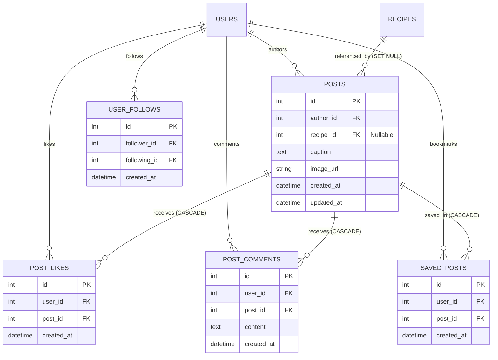

# Technical Specification: Simmer Sprint 3 Social Feed, Interactions & Following

**Feature / Milestone:** Sprint 3 — Social Feed, Community Interactions & Follower Network  
**Status:** Approved  
**Date:** 2026-11-09  
**Engineering Model:** Full-Stack Vertical Slice Architecture  
**Team Members (Full-Stack Developers):**  
- **Maximo Mora** (Product Owner & Full-Stack Developer — Feature Lead for US3.3)  
- **Ulises Diaz** (Scrum Master & Full-Stack Developer)  
- **Bryan Moreno** (Full-Stack Developer)  
- **John Weaver** (Full-Stack Developer)  
- **Benjamin Ong** (Full-Stack Developer)  

**Related Documents:**
- [intent.md](./intent.md) — Sprint 3 User Stories & Acceptance Scenarios  
- [Sprint_Plan_3.md](../Sprint_Plan_3.md) — Sprint 3 Work Breakdown & Schedule  
- [Architecture_Design.md](../Architecture_Design.md) — System Architecture & Data Layer  

---

## 1. Scope & Engineering Model

### 1.1 Scope Overview
This specification details the technical contracts, database schemas, Pydantic DTOs, REST API endpoints, frontend component interactions, and verification matrices for Sprint 3 of Simmer.

Sprint 3 delivers six items (21 total story points, 104 ideal engineering hours):
1. **US3.1:** Publish Food Posts with Photos & Recipe Links — *5 pts*
2. **US3.2:** Edit & Delete Posts with Author Authorization — *3 pts*
3. **US3.3:** Likes & Threaded Comments on Community Posts (Lead: Maximo Mora) — *5 pts*
4. **US3.4:** Bookmark / Save Posts to Profile Collection — *3 pts*
5. **US3.5:** Follow Users & Timeline Feed Delivery — *3 pts*
6. **SPK-3.1:** Grocery Checklist Aggregation Spike — *2 pts*

---

### 1.2 Full-Stack Vertical Slice Architecture
All 5 team members continue operating as **Full-Stack Developers**. Each feature slice is owned end-to-end:
`Database Migration` $\rightarrow$ `FastAPI Route & DTO` $\rightarrow$ `React Component & State` $\rightarrow$ `Automated Pytest & Vitest Suites`.

```
+-------------------------------------------------------------------------------+
|                      VERTICAL SLICE FEATURE OWNERSHIP                         |
|                                                                               |
|  [US3.1: Posts]   [US3.2: Lifecycle]   [US3.3: Likes/Comments]  [US3.4] [US3.5]|
+-------------------------------------------------------------------------------+
|  Presentation: React 18, Tailwind CSS, Feed Tabs, Comment Drawer, Heart Icon  |
+-------------------------------------------------------------------------------+
|  Application: FastAPI, Pydantic v2 DTOs, Auth Dependencies, Sanitization      |
+-------------------------------------------------------------------------------+
|  Persistence: SQLAlchemy 2.0, SQLite / Alembic Migrations, CASCADE Rules      |
+-------------------------------------------------------------------------------+
|  Verification: Pytest (Backend API) & Vitest (Frontend UI & Optimistic State) |
+-------------------------------------------------------------------------------+
```

---

## 2. Database Schema & Relational Models



### 2.1 Table: `posts`
Stores user-authored dish posts shared to the community feed:

| Column | Type | Constraints | Description |
| :--- | :--- | :--- | :--- |
| `id` | Integer | Primary Key, Autoincrement | Unique post ID |
| `author_id` | Integer | Foreign Key (`users.id`, ondelete: CASCADE), Not Null, Index | Post author |
| `recipe_id` | Integer | Foreign Key (`recipes.id`, ondelete: SET NULL), Nullable, Index | Linked recipe |
| `caption` | Text | Not Null | Post caption / description (1 to 2,000 chars) |
| `image_url` | String(255) | Not Null | Food photograph URL |
| `created_at` | DateTime | Not Null, Default: `UTC now`, Index | Post timestamp |
| `updated_at` | DateTime | Not Null, Default: `UTC now` | Last edited timestamp |

### 2.2 Table: `post_likes`
Tracks user likes on community posts with duplicate prevention:

| Column | Type | Constraints | Description |
| :--- | :--- | :--- | :--- |
| `id` | Integer | Primary Key, Autoincrement | Unique like ID |
| `user_id` | Integer | Foreign Key (`users.id`, ondelete: CASCADE), Not Null | Liker user ID |
| `post_id` | Integer | Foreign Key (`posts.id`, ondelete: CASCADE), Not Null, Index | Target post ID |
| `created_at` | DateTime | Not Null, Default: `UTC now` | Timestamp liked |

*Constraint:* `UniqueConstraint("user_id", "post_id", name="uq_user_post_like")`

### 2.3 Table: `post_comments`
Stores discussion comments under posts:

| Column | Type | Constraints | Description |
| :--- | :--- | :--- | :--- |
| `id` | Integer | Primary Key, Autoincrement | Unique comment ID |
| `user_id` | Integer | Foreign Key (`users.id`, ondelete: CASCADE), Not Null | Comment author |
| `post_id` | Integer | Foreign Key (`posts.id`, ondelete: CASCADE), Not Null, Index | Target post ID |
| `content` | Text | Not Null | Comment text (1 to 1,000 chars) |
| `created_at` | DateTime | Not Null, Default: `UTC now`, Index | Timestamp posted |

### 2.4 Table: `saved_posts`
Tracks bookmarked posts in personal collections:

| Column | Type | Constraints | Description |
| :--- | :--- | :--- | :--- |
| `id` | Integer | Primary Key, Autoincrement | Unique bookmark ID |
| `user_id` | Integer | Foreign Key (`users.id`, ondelete: CASCADE), Not Null | Bookmark owner |
| `post_id` | Integer | Foreign Key (`posts.id`, ondelete: CASCADE), Not Null, Index | Target post ID |
| `created_at` | DateTime | Not Null, Default: `UTC now` | Timestamp bookmarked |

*Constraint:* `UniqueConstraint("user_id", "post_id", name="uq_user_saved_post")`

### 2.5 Table: `user_follows`
Stores the follower/following social graph:

| Column | Type | Constraints | Description |
| :--- | :--- | :--- | :--- |
| `id` | Integer | Primary Key, Autoincrement | Follow link ID |
| `follower_id` | Integer | Foreign Key (`users.id`, ondelete: CASCADE), Not Null, Index | User following |
| `following_id` | Integer | Foreign Key (`users.id`, ondelete: CASCADE), Not Null, Index | User being followed |
| `created_at` | DateTime | Not Null, Default: `UTC now` | Timestamp followed |

*Constraints:* 
- `UniqueConstraint("follower_id", "following_id", name="uq_user_follower_following")`
- `CheckConstraint("follower_id != following_id", name="ck_no_self_follow")`

---

## 3. Pydantic DTOs & TypeScript Interfaces

### 3.1 Backend Pydantic Schemas (`backend/app/schemas/post.py`)
```python
from pydantic import BaseModel, Field, HttpUrl
from typing import Optional, List
from datetime import datetime

class PostCreate(BaseModel):
    caption: str = Field(..., min_length=1, max_length=2000)
    image_url: str = Field(..., max_length=255)
    recipe_id: Optional[int] = None

class PostUpdate(BaseModel):
    caption: Optional[str] = Field(None, min_length=1, max_length=2000)
    image_url: Optional[str] = Field(None, max_length=255)

class RecipeCardSummary(BaseModel):
    id: int
    title: str
    cuisine: Optional[str] = None
    meal_type: Optional[str] = None
    difficulty: str
    cook_time_mins: int

class PostOut(BaseModel):
    id: int
    author_id: int
    author_username: str
    author_avatar_url: Optional[str] = None
    caption: str
    image_url: str
    recipe: Optional[RecipeCardSummary] = None
    likes_count: int = 0
    comments_count: int = 0
    has_liked: bool = False
    has_bookmarked: bool = False
    created_at: datetime
    updated_at: datetime

class FeedResponse(BaseModel):
    total: int
    limit: int
    offset: int
    items: List[PostOut]

class CommentCreate(BaseModel):
    content: str = Field(..., min_length=1, max_length=1000)

class CommentOut(BaseModel):
    id: int
    post_id: int
    user_id: int
    username: str
    avatar_url: Optional[str] = None
    content: str
    created_at: datetime

class LikeToggleResponse(BaseModel):
    liked: bool
    likes_count: int

class BookmarkToggleResponse(BaseModel):
    bookmarked: bool

class FollowStatusResponse(BaseModel):
    following: bool
    followers_count: int
    following_count: int
```

### 3.2 Frontend TypeScript Interfaces (`frontend/src/types/post.ts`)
```typescript
export interface Post {
  id: number;
  author_id: number;
  author_username: string;
  author_avatar_url?: string | null;
  caption: string;
  image_url: string;
  recipe?: {
    id: number;
    title: string;
    cuisine?: string | null;
    meal_type?: string | null;
    difficulty: string;
    cook_time_mins: number;
  } | null;
  likes_count: number;
  comments_count: number;
  has_liked: boolean;
  has_bookmarked: boolean;
  created_at: string;
  updated_at: string;
}

export interface Comment {
  id: number;
  post_id: number;
  user_id: number;
  username: string;
  avatar_url?: string | null;
  content: string;
  created_at: string;
}

export interface FeedResult {
  total: number;
  limit: number;
  offset: number;
  items: Post[];
}
```

---

## 4. REST API Endpoint Specifications

### 4.1 Posts & Feed Endpoints
- **`GET /api/v1/posts`**: Global community feed in reverse-chronological order. (Query: `limit`, `offset`)
- **`POST /api/v1/posts`**: Publish a new post. (Auth required, Body: `PostCreate`, Response: `201 Created` $\rightarrow$ `PostOut`)
- **`GET /api/v1/posts/{id}`**: Read a single post with recipe summary.
- **`PUT /api/v1/posts/{id}`**: Update post caption or photo. (Auth required, Author only)
- **`DELETE /api/v1/posts/{id}`**: Delete post and cascade children. (Auth required, Author or Admin, `204 No Content`)
- **`GET /api/v1/feed`**: Following feed delivering chronological posts from followed users. (Auth required)

### 4.2 Likes & Comments Endpoints (US3.3 Lead: Maximo Mora)
- **`POST /api/v1/posts/{id}/like`**: Toggle like state. (Auth required, Response: `LikeToggleResponse`)
- **`GET /api/v1/posts/{id}/comments`**: List comments for a post. (Query: `limit`, `offset`)
- **`POST /api/v1/posts/{id}/comments`**: Add a comment. (Auth required, Body: `CommentCreate`, Response: `201 Created` $\rightarrow$ `CommentOut`)
- **`DELETE /api/v1/comments/{id}`**: Delete comment. (Auth required, Author only, `204 No Content`)

### 4.3 Bookmarks & Following Endpoints
- **`POST /api/v1/posts/{id}/bookmark`**: Toggle bookmark state. (Auth required, Response: `BookmarkToggleResponse`)
- **`GET /api/v1/users/me/saved-posts`**: Get current user's bookmarked posts. (Auth required, Response: `List[PostOut]`)
- **`POST /api/v1/users/{id}/follow`**: Toggle follow/unfollow user. (Auth required, Response: `FollowStatusResponse`)
- **`GET /api/v1/users/{id}/followers`**: Get user's follower and following counts & lists.

---

## 5. Frontend UI/UX Specifications

### 5.1 Community Home Feed (`frontend/src/pages/Home.tsx` / `FeedPage.tsx`)
1. **Feed Tab Switcher:** Dual-pill toggle:
   - `[ Global Community ]` — Shows all posts chronologically.
   - `[ Following ]` — Shows posts from followed creators.
2. **"Share a Dish" Action Button:** Opens the `PostFormModal` to author a post.
3. **Interactive Post Card (`PostCard.tsx`):**
   - Author header with avatar, username, and time ago.
   - High-resolution food photograph.
   - Interactive recipe chip: Displays recipe title, cuisine badge, and cook time; clicking opens recipe details.
   - Caption text with formatted hashtags.
   - Action toolbar: Animated Heart (Likes), Bubble (Comments Drawer), Ribbon (Bookmark), and Share.

### 5.2 Slide-Out Comment Thread Drawer (`CommentDrawer.tsx` — US3.3)
1. Slide-out panel from the right or expanding drawer below the post.
2. Scrollable comment list showing avatar, username, timestamp, and message.
3. Sticky bottom input bar with auto-resizing text area and "Post" button.

### 5.3 Profile Social Enhancements (`ProfilePage.tsx`)
1. **Social Metrics Bar:** Shows count of `Followers` and `Following`.
2. **"Saved Posts" Tab:** Placed alongside "My Recipes" and "Cooking History", displaying a grid of bookmarked posts.

---

## 6. Full-Stack Vertical Slice Ownership Matrix

*(Note: Developer pairings will be finalized during the Sprint 3 kickoff meeting; Maximo Mora is confirmed to lead US3.3, and Ulises Diaz serves as Scrum Master.)*

| User Story | Points | Full-Stack Owner(s) | Backend & Persistence Deliverables | Frontend UI Deliverables | Verification Suites |
| :--- | :---: | :--- | :--- | :--- | :--- |
| **US3.1: Publish Posts** | 5 pts | *TBD at Kickoff* (Full-Stack Team) | `posts` schema migration, foreign key to recipes, CRUD endpoints | PostCard component, PostFormModal with photo preview & recipe dropdown | `test_posts.py`: Authoring validation, recipe linking |
| **US3.2: Edit/Delete Posts** | 3 pts | *TBD at Kickoff* (Full-Stack Team) | Update/delete endpoints, author-only permission check (`_require_author`) | Post action dropdown (Edit/Delete), edit modal, confirmation alert | `test_posts.py`: 403 Forbidden check, CASCADE verification |
| **US3.3: Likes & Comments** | 5 pts | **Maximo Mora** (Lead) & Full-Stack Team | `post_likes` & `post_comments` schemas, toggle like, comments CRUD | Animated Heart button, optimistic UI update, slide-out comment drawer | `test_likes_comments.py`: Idempotency, XSS sanitization |
| **US3.4: Bookmark Posts** | 3 pts | *TBD at Kickoff* (Full-Stack Team) | `saved_posts` join table, bookmark toggle, saved-posts list query | Bookmark ribbon button, "Saved Posts" tab on user profile page | `test_bookmarks.py`: User collection isolation, deleted post fallback |
| **US3.5: Follow & Timeline** | 3 pts | *TBD at Kickoff* (Full-Stack Team) | `user_follows` table, follow/unfollow route, chronological feed query | Following vs. Global feed tabs, FollowButton component, profile counts | `test_follows_feed.py`: Follow query logic, empty state |
| **SPK-3.1: Grocery Spike** | 2 pts | *TBD at Kickoff* (Full-Stack Team) | Prototype ingredient stemming & fractional unit converter sandbox | Recommendation documentation for Sprint 4 planning | Benchmark script & findings report |
| **Scrum Facilitation & QA** | — | **Ulises Diaz** (Scrum Master) | Sprint ceremonies, CI/CD pipeline health, review coordination | Standup log tracking, retrospective facilitation | Regression test suite (100% pass rate across all 76 tests) |

---

## 7. Security, Performance & Data Integrity Guardrails

1. **XSS Defense:** Comments and captions rendered safely via React DOM text nodes; HTML sanitization enforced at the API layer.
2. **Fan-Out-on-Read Optimization:** `GET /api/v1/feed` filters via `WHERE posts.author_id IN (SELECT following_id FROM user_follows WHERE follower_id = :user_id)`. Composite index on `user_follows(follower_id, following_id)` ensures sub-50ms execution.
3. **Authorization Enforcement:** Only the author of a post or comment can edit or delete it; administrators retain moderation deletion rights.
4. **Referential Integrity:** Deleting a post automatically cascades and removes all related likes, comments, and saved entries (`ON DELETE CASCADE`). If a referenced recipe is deleted, `recipe_id` in `posts` is cleanly set to `NULL` (`ON DELETE SET NULL`) without destroying the post.

---

## 8. Test Plan & Acceptance Verification Matrix

| Test Suite | Scope | Target Verification | Passing Criteria |
| :--- | :---: | :--- | :--- |
| `tests/test_posts.py` | API / DB | Post authoring, recipe linking, edit/delete permissions | 201 Created; 403 Forbidden on non-author edit; 204 on delete; recipe chip association |
| `tests/test_likes_comments.py` | API / Integration | Like toggling, comment creation, listing, and deletion | Like count increments/decrements idempotently; comments sanitized against script injection |
| `tests/test_bookmarks.py` | API / Integration | Bookmarking posts and fetching saved collections | Saved posts scoped strictly to authenticated user; 200 OK |
| `tests/test_follows_feed.py` | API / Query | Follow/unfollow toggling, self-follow rejection, following feed | 400 on self-follow; following feed returns only followed authors in reverse-chronological order |
| `tests/test_regressions.py` | Regression | Full Sprint 1 & Sprint 2 suites (Auth, RBAC, Recipes, Search, Tags) | **All 76 existing backend tests continue passing 100%** |
